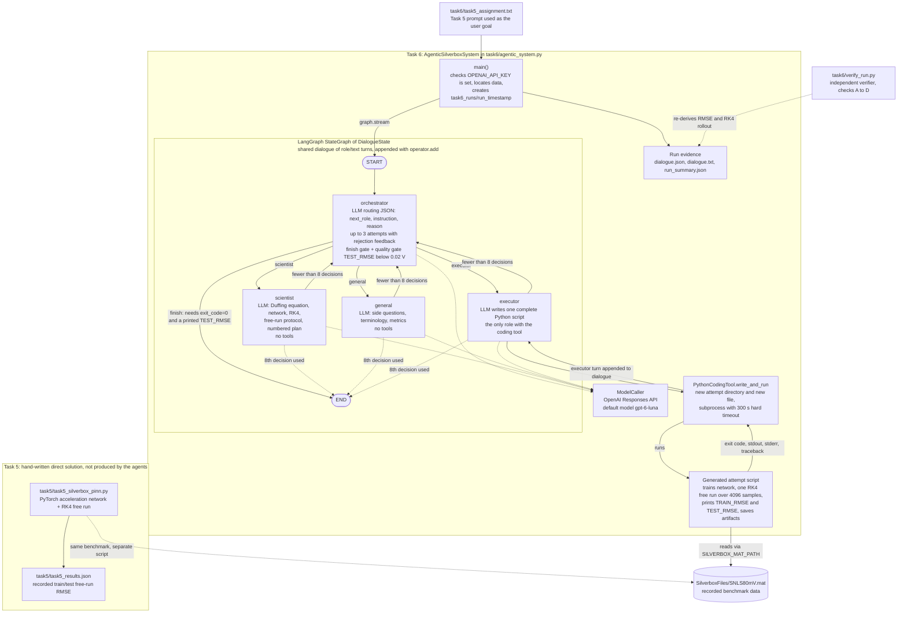
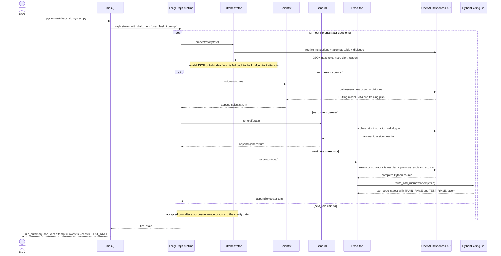
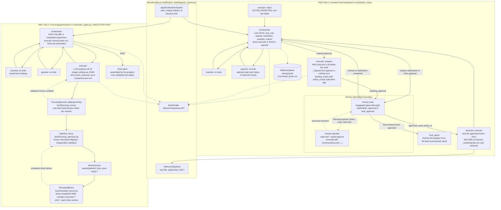
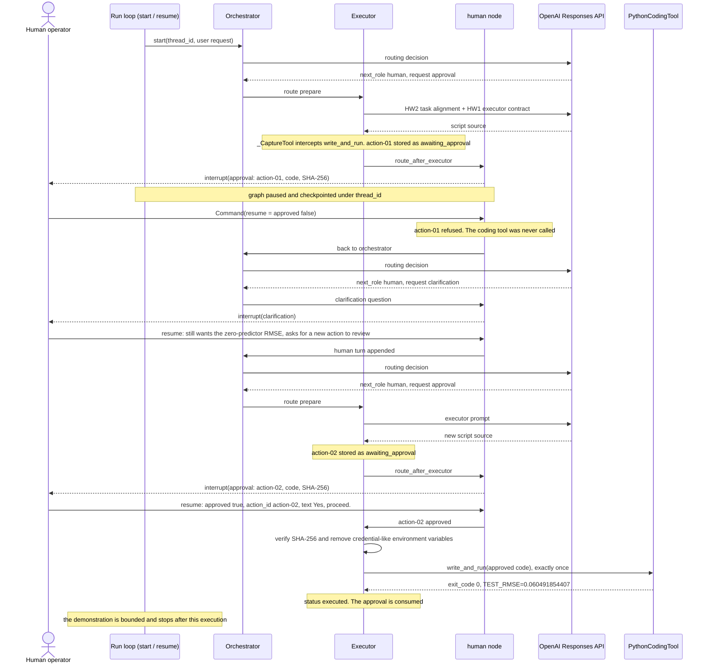
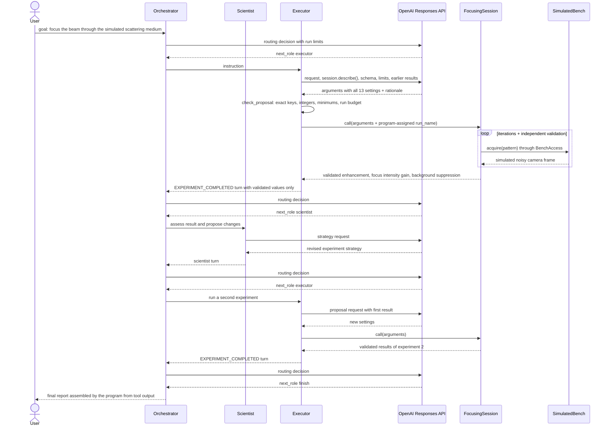
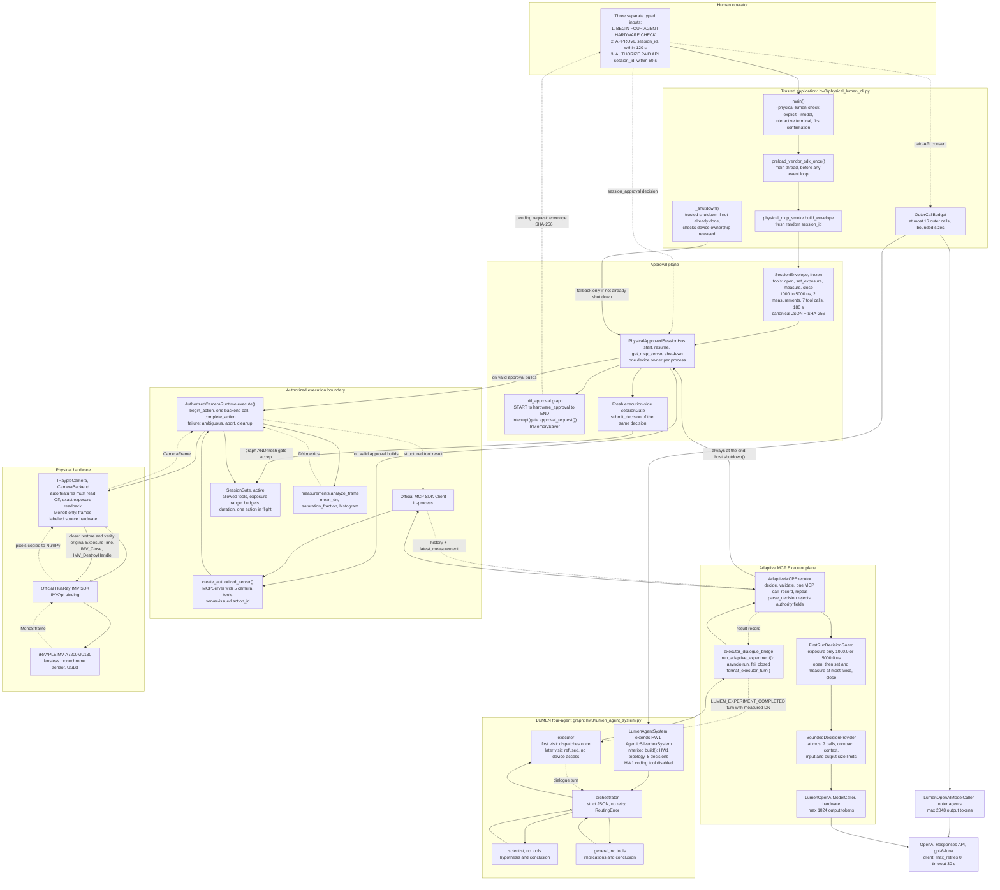
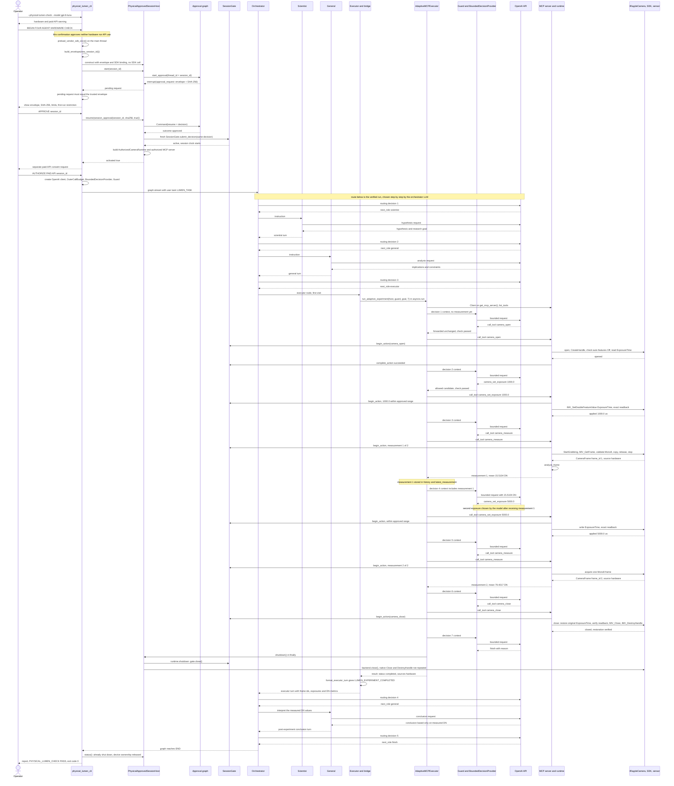

# LUMEN / PhotonicsAI — System Architecture and Sequence Diagrams (HW1, HW2, HW3)

This document gives editable Mermaid diagrams of the three homework systems. Every diagram was
drawn from the source code in this repository. Section 5 maps each diagram component to its
source file.

## 1. Architecture evolution

All three homeworks use **the same four-role LangGraph system** from HW1
(`task6/agentic_system.py`, class `AgenticSilverboxSystem`). Later homeworks subclass it. They do
not modify it.

| Homework | What the four roles control | Executor's only capability | Human role | Physical hardware |
|---|---|---|---|---|
| **HW1** (Tasks 5/6) | Silverbox nonlinear-oscillator modelling (neural acceleration network + RK4 free run, the "PINN / neural state-space" task) | `PythonCodingTool`: writes a new Python script and runs it as a subprocess (300 s timeout) | None inside the graph | **None.** The data is a recorded benchmark file (`SNLS80mV.mat`) |
| **HW2 Task 1** | The same Silverbox work, plus a model-selected `human` destination | The same coding tool. It runs only after the human approves the exact SHA-256-bound action | LangGraph `interrupt()` / `Command(resume=...)` for clarification, code approval and final-measurement approval | **None** |
| **HW2 Task 2** | Simulated wavefront shaping (focusing through a scattering medium) | `FocusingSession.call(arguments)`, one bounded simulated experiment | None (the simulated tool needs no approval) | **None.** DMD, scattering medium and camera are all **simulated** |
| **HW3** (LUMEN) | Camera-exposure experiment on a real sensor | The Executor dispatches **once**, through a bridge, to an adaptive MCP executor. Each MCP tool call is chosen by an LLM and enforced by `SessionGate` | Typed first confirmation, real LangGraph session approval, separate paid-API consent | **Yes.** iRAYPLE MV-A7200MU130, a **lensless monochrome** sensor, through the official HuaRay IMV SDK |

Key distinctions:

- HW1's PINN/Silverbox system is a **numerical modelling task on recorded data**. It is distinct
  from HW3's physical camera and shares no hardware path with it.
- HW2's optics experiment is **simulated**. The DMD, the transmission matrix *T* and the camera
  noise are generated in software (`hw2/simulated_bench.py`). No hardware was used.
- HW3 uses a **real lensless monochrome sensor**. Its data are **uncalibrated digital numbers
  (DN)** from Mono8 frames.

---

## 2. HW1 — Four-agent LangGraph system (Tasks 5 and 6)

### Figure 1 — HW1 architecture

**Explanation.** The graph has four LLM-backed nodes and one shared dialogue. The orchestrator's
routing is itself an LLM call. A malformed reply or an illegal `finish` is sent back to the LLM
with the error (at most three attempts). The program never substitutes a route. Only the
executor owns `PythonCodingTool`. Each attempt is written to a new directory and run with a hard
300 s timeout. `finish` is accepted only after an executor turn with `exit_code=0` and a printed
`TEST_RMSE`. While the best result is not below 0.02 V and at least two decisions remain, the
quality gate also rejects `finish`. Task 5 is a separate, hand-written solution to the same
benchmark. It was not produced by the agents. The README keeps the two results apart (Task 5
test RMSE 0.0016 V; Task 6 agent run 1 test RMSE 0.0595 V).

### Figure 2 — HW1 sequence

**Explanation.** The orchestrator LLM chooses each step from the dialogue. General participation
is optional. In the two recorded validated runs the orchestrator chose only `scientist`,
`executor` and `finish`:
`task6/validated_run`: scientist → executor → finish;
`task6/validated_run_v2`: scientist → executor → scientist → executor → scientist → executor →
executor → finish.
The General branch is shown because the code supports it, not because it was used in those
runs.

---

## 3. HW2 — Human-in-the-loop code approval (Task 1) and simulated optics (Task 2)

### Figure 3 — HW2 architecture

**Explanation.** The two HW2 tasks are separate systems on the same HW1 base.

- **Task 1** adds a `human` node that the orchestrator LLM selects itself. Preparation,
  approval and execution are separate graph steps. The executor LLM writes code, but the tool
  call is captured, not executed. The human then judges the exact `action_id` and code SHA-256.
  Only a structured `{"approved": true, "action_id": <same id>}` approves. Anything else refuses
  (fail closed). An approved action runs exactly once and is then marked `executed`. The node
  `executor: reject` is the fail-closed path for any other executor entry.
- **Task 2** keeps the HW1 topology. It replaces the coding tool with one bounded **simulated**
  focusing tool. There is no human approval, no coding tool and no hardware driver. Every
  reported number comes from the tool's independent validation measurements.

### Figure 4 — HW2 Task 1 sequence (recorded refusal, clarification and approval)

This follows the recorded run `task6_runs/hw2_task1_hard_20261012_161518/` (documented in
`submission/HW2_Report_Final.md`, section 4). The user asked for a script that computes the
zero-predictor Test RMSE without training a model.

**Explanation.** The diagram shows the real human decisions: a refusal of `action-01`, a
clarification answer, then approval of `action-02` ("Yes, proceed."). According to the recorded
evidence, the refused code never ran (`tool_calls_running_refused_code = 0`). The approved code
ran once, and its hash matched the approved hash. The code also implements the `final_approval`
path (Figure 3), but this recorded demonstration stopped before it. No physical hardware takes
part in HW2.

### Figure 5 — HW2 Task 2 sequence (simulated focusing, recorded live run)

This follows the recorded live run `task6_runs/hw2_task2_live_20261012_211839/`. Orchestrator
decisions: executor → scientist → executor → finish. There were 2 tool calls, both completed.

**Explanation.** The executor LLM chooses every experimental setting. The program only
validates the settings (it never fills in or clips them) and assembles the final report from
tool output. All optics here are **simulated**: one fixed random complex Gaussian transmission
matrix, a binary amplitude DMD and a shot/read-noise camera model.

---

## 4. HW3 — LUMEN on the physical iRAYPLE camera

### Figure 6 — HW3 architecture

**Explanation.** The LUMEN outer graph is the **original HW1 four-role graph**.
`LumenAgentSystem` inherits `build()` unchanged and replaces only the prompts and the Executor
body. The Orchestrator, Scientist and General have no tools. Nothing in the dialogue grants
authority. Only the Executor can reach the camera, and only once. It does so through
`run_adaptive_experiment()`, which runs `AdaptiveMCPExecutor` on the single approved host.

Inside that loop, the **LLM chooses every MCP action**. Trusted code bounds it in layers:

1. `FirstRunDecisionGuard` restricts the first-run protocol. It refuses but never edits a
   decision.
2. `BoundedDecisionProvider` caps the number of model calls and the context size.
3. `parse_decision` rejects malformed decisions and decisions carrying session, approval or hash
   fields.
4. The **`SessionGate`**, which a human approved through LangGraph and which is re-validated by a
   fresh execution-side gate, authorizes or refuses each call. A refused call never reaches the
   backend.
5. `IRaypleCamera` adds device-level checks. Auto features must read `Off`, the exposure readback
   must match the request exactly (nothing is clamped), and frames must be Mono8.

Each measurement's DN statistics go back into the executor's history and `latest_measurement`
before the next model decision. That is the physical feedback loop. Shutdown always runs:
`AdaptiveMCPExecutor` calls `host.shutdown()` in a `finally` block, and the CLI repeats it only
if the host is not already shut down. On close, `IRaypleCamera` restores the original
`ExposureTime` and verifies it by readback.

### Figure 7 — HW3 sequence (four-agent physical run)

**Explanation.** The diagram has three human gates in a fixed order: a typed confirmation, a
real LangGraph approval of the exact envelope, and a separate paid-API consent. The OpenAI
client is created only after all three succeed.

- **Hardware decisions.** The six MCP tool calls and the final `finish` are seven decisions
  made by the hardware model. This is exactly the D5A budget (`MAX_MODEL_DECISIONS = 7`), with
  no slack. The first-run guard allows only the order open → (set → measure) × 2 → close. A
  measurement is allowed only after a newly set exposure. So the second exposure decision can
  only be made after measurement 1 is in the executor's history. The `PASS` verdict checks this
  explicitly (`feedback_evidence`).
- **Outer order.** The diagram shows the verified physical run. Its role visit order was
  orchestrator → scientist → orchestrator → general → orchestrator → executor → orchestrator →
  general → orchestrator. Each step was chosen by an orchestrator LLM routing decision; the route
  is not hardcoded and the code permits other orders. The `PASS` verdict guarantees that all four
  roles took part, the Executor dispatched exactly once, and a Scientist or General conclusion
  followed the completed Executor turn. In this run the post-experiment conclusion was written
  by **General**.
- **API requests.** 5 Orchestrator + 1 Scientist + 2 General = 8 outer-agent requests, plus 7
  hardware Executor decisions, for 15 OpenAI API requests in total.
- **Restoration.** Restoration happens in the model-selected `camera_close`. The trusted
  `host.shutdown()` then closes the gate and releases the backend without repeating the native
  close calls.

---

## 5. Source traceability

| Diagram component | Figure(s) | Source file(s) |
|---|---|---|
| `AgenticSilverboxSystem`, `DialogueState`, `build()`, routing, quality gate, `MAX_DECISIONS = 8` | 1, 2, 3, 6 | `task6/agentic_system.py` |
| `ModelCaller` (OpenAI Responses API) | 1, 2, 3 | `task6/agentic_system.py` |
| `PythonCodingTool.write_and_run` (new attempt directory, 300 s timeout) | 1, 2, 3, 4 | `task6/agentic_system.py` |
| Task 5 prompt / hand-written solution / recorded result | 1 | `task6/task5_assignment.txt`, `task5/task5_silverbox_pinn.py`, `task5/task5_results.json` |
| Independent HW1 verifier (checks A–D) | 1 | `task6/verify_run.py` |
| Recorded HW1 runs (decision sequences, RMSE) | 2 | `task6/validated_run/run_summary.json`, `task6/validated_run_v2/run_summary.json` |
| `HumanInTheLoopSystem`, `human` node, `interrupt()`, `Command(resume=...)`, `pending_action`, `_CaptureTool`, `secrets_removed_from_environment`, `final_report` | 3, 4 | `hw2/task1_hitl.py` |
| Recorded refusal / clarification / approval demonstration | 4 | `hw2/demo_task1_hard.py`; evidence summarised in `submission/HW2_Report_Final.md` §4 |
| `FocusingAgentSystem`, `check_proposal`, run limits, program-built final report | 3, 5 | `hw2/task2_agent.py`, `hw2/demo_task2_live.py` |
| `FocusingSession.call` | 3, 5 | `hw2/focusing_tool.py` |
| `optimize_focus`, `BenchAccess` | 3, 5 | `hw2/focusing_optimizer.py` |
| `SimulatedBench` (DMD, transmission matrix *T*, noise model) | 3, 5 | `hw2/simulated_bench.py` |
| Trusted CLI, three human gates, `OuterCallBudget`, verdict, `_shutdown` | 6, 7 | `hw3/physical_lumen_cli.py` |
| `FirstRunDecisionGuard`, `EXPOSURE_CANDIDATES_US = (1000.0, 5000.0)`, `MAX_MODEL_DECISIONS = 7`, approval/consent prompts, `feedback_evidence` | 6, 7 | `hw3/physical_adaptive_cli.py` |
| Session envelope values (4 tools, 1000–5000 µs, 2 measurements, 7 tool calls, 180 s) | 6, 7 | `hw3/physical_mcp_smoke.py` (`build_envelope`, `new_session_id`) |
| `LumenAgentSystem`, strict routing, single dispatch | 6, 7 | `hw3/lumen_agent_system.py` |
| `PhysicalApprovedSessionHost`, `preload_vendor_sdk_once`, `PHYSICAL_LIMITS`, device ownership | 6, 7 | `hw3/physical_approved_session_host.py` |
| `start` / `resume` / `get_mcp_server` / `shutdown`, dual validation (graph + fresh gate) | 6, 7 | `hw3/approved_session_host.py` |
| Approval graph `START → hardware_approval → END` | 6, 7 | `hw3/hitl_approval.py` |
| `SessionEnvelope`, SHA-256, `SessionGate` state machine and budgets | 6, 7 | `hw3/session_policy.py` |
| `AuthorizedCameraRuntime.execute`, ambiguous-outcome abort, `shutdown` | 6, 7 | `hw3/authorized_camera.py` |
| Authorized MCP server, server-issued `action_id` | 6, 7 | `hw3/authorized_mcp.py` |
| `IRaypleCamera` (open, exposure write and readback, Mono8 capture, restore on close) | 6, 7 | `hw3/irayple_camera.py` |
| `AdaptiveMCPExecutor`, `parse_decision`, event history, `latest_measurement` | 6, 7 | `hw3/executor_mcp_loop.py` |
| `run_adaptive_experiment`, `format_executor_turn`, `LUMEN_EXPERIMENT_COMPLETED` | 6, 7 | `hw3/executor_dialogue_bridge.py` |
| `BoundedDecisionProvider` | 6, 7 | `hw3/llm_decision_provider.py` |
| `LumenOpenAIModelCaller`, `create_live_openai_client` (max_retries 0, 30 s) | 6, 7 | `hw3/openai_model_caller.py` |
| `analyze_frame` (DN metrics) | 6, 7 | `hw3/measurements.py` |
| `CameraBackend`, `CameraFrame`, source labels | 6 | `hw3/camera_contract.py` |

---

## 6. Physical experimental evidence (HW3)

The operator reported the following outcome of the four-agent physical run
(`hw3/physical_lumen_cli.py`) on the real iRAYPLE MV-A7200MU130:

| Item | Observed value |
|---|---|
| Verdict / exit code | `PASS`, exit code 0 |
| Agent participation | Orchestrator, Scientist, General and Executor all took part. Role visit order: orchestrator → scientist → orchestrator → general → orchestrator → executor → orchestrator → general → orchestrator |
| Model | `gpt-6-luna` |
| Real API calls | Reported by the terminal: 8 outer-agent requests (5 Orchestrator, 1 Scientist, 2 General) + 7 hardware Executor requests = **15** in total |
| Authorized MCP tool calls | 6 (open, set exposure, measure, set exposure, measure, close) |
| Physical measurements | 2 Mono8 frames, source `hardware` |
| Measurement 1 | exposure 1000 µs, mean **15.5104 DN** |
| Measurement 2 | exposure 5000 µs, mean **79.4017 DN** |
| Adaptivity | the second exposure decision was made after measurement 1 had been received |
| Restoration and shutdown | succeeded. MV Viewer independently confirmed that `ExposureTime` returned to 5000 µs |
| Recording | the operator recorded the live demonstration: `HW3_03_Four_Agent_LUMEN_D6A.mp4` (inspected) |

The measured values came from the physical sensor, not from `FakeCamera`:

- **Source labels.** `PhysicalApprovedSessionHost` constructs only an `IRaypleCamera` backend.
  `AuthorizedCameraRuntime` rejects any frame whose source differs from the backend's declared
  source.
- **Verdict check.** The PASS verdict requires the observed sources to be exactly `["hardware"]`.

**Three successful physical experiments.** The four-agent run above (D6A) is one of three
successful physical experiments. The other two are:

- **D4:** a fixed six-call MCP diagnostic, `hw3/physical_mcp_smoke.py`, which is not LLM-driven.
- **D5A:** an LLM-driven adaptive MCP experiment, `hw3/physical_adaptive_cli.py`.

D5A and D6A each contain exactly one feedback-driven exposure correction. All values and their
evidence sources are given in `hw3/docs/physical_experiments.md`.

Screenshots and video recordings exist as separate files in the repository root:

| Recording | Evidence status |
|---|---|
| `HW3_01_Physical_MCP_D4.mp4` | Successful D4 run according to the operator; not independently inspected |
| `HW3_02_Adaptive_LLM_D5A.mp4` | Inspected |
| `HW3_03_Four_Agent_LUMEN_D6A.mp4` | Inspected |

Screenshots include `mvviewer screenshot.png`. `demo2 hw3.mp4` is the HW2 *simulated* optics demo
and is not HW3 hardware evidence. **Media files are not embedded in this document.** No image, raw
frame or report file was saved by the runs themselves (by design of the CLIs).

**Rendered figures.** All eight figures are available as SVG files in `hw3/docs/figures/`:

| Figure | File |
|---|---|
| 1 | `hw1_architecture.svg` |
| 2 | `hw1_sequence.svg` |
| 3 | `hw2_architecture.svg` |
| 4 | `hw2_hitl_sequence.svg` |
| 5 | `hw2_simulation_sequence.svg` |
| 6 | `hw3_architecture.svg` |
| 7 | `hw3_sequence.svg` |
| 8 | `hw1_hw2_hw3_overview.svg` (integrated HW1/HW2/HW3 architecture, Section 9) |

## 7. What was simulated, offline-tested and verified on hardware

| Component | Simulated | Offline-tested (mocks/fakes) | Verified on physical hardware |
|---|---|---|---|
| HW1 Silverbox modelling (PINN / neural state-space, RK4) | No (recorded benchmark data, not simulation of hardware) | Independent verifier `task6/verify_run.py` | Not applicable, no hardware |
| HW2 Task 1 HITL code approval | No optics involved | `hw2/tests/test_task1_hitl.py` | Not applicable. Real LLM and real human decisions, no hardware |
| HW2 Task 2 focusing experiment | **Yes**: DMD, transmission matrix, camera noise | `hw2/tests/` (bench, optimizer, tool, agent) | **No** |
| HW3 approval graph, SessionGate, runtime, MCP server, executor loop, bridge | Offline path uses `FakeCamera` (labelled synthetic) | `hw3/tests/` (baseline stated as 1004 passing tests) | **Yes**, in the four-agent run above |
| HW3 `IRaypleCamera` + HuaRay IMV SDK | No | `hw3/tests/` with a mocked SDK binding | **Yes**: open, exposure write/readback, two Mono8 frames, restoration |
| HW3 LLM-driven adaptive exposure choice | No | Scripted providers in `hw3/tests/` | **Yes**: real `gpt-6-luna` decisions on real measurements |

## 8. Scientific scope and limitations

- **Distinct systems.** HW1's PINN/Silverbox system works on a recorded electrical benchmark
  (`SNLS80mV.mat`). It is unrelated to the HW3 camera.
- **HW2 optics are simulated.** No laser, DMD, scattering sample or camera was used. HW2
  enhancement values are properties of the simulator.
- **HW3 sensor.** HW3 uses a real, **lensless** monochrome sensor. No lens was mounted, so **no
  optical focus or image formation** has been demonstrated.
- **Uncalibrated DN.** HW3 values are **uncalibrated digital numbers** from Mono8 frames. No
  absolute irradiance, no calibrated sensitivity, no dark-frame correction and **no linearity**
  of DN versus exposure has been demonstrated. Two points at different exposures are not a
  linearity test. The illumination was ambient and was not measured.
- **Restricted exposure set.** The first physical adaptive experiment restricts exposure
  candidates to **1000 µs and 5000 µs** (`FirstRunDecisionGuard`). This is narrower than the
  approved 1000–5000 µs envelope, which is in turn narrower than the SDK range. The model could
  choose only between these two values. The result is therefore a demonstration of
  feedback-driven selection, not of fine exposure optimisation. The second measurement
  (79.4 DN) is near, but not exactly at, the 70 DN target.
- **Limits are enforced by trusted code.** The LLM chooses actions, but trusted code enforces
  the physical limits: the guard, `parse_decision`, the human-approved `SessionGate`, and the
  device checks in `IRaypleCamera`. The model cannot widen the envelope, supply an `action_id`,
  or approve a session.
- **Crash limitation.** A forcibly killed process cannot restore `ExposureTime`. The CLI states
  this and advises checking it in MV Viewer.
- **Run-order source.** The order of the two measurements (1000 µs first, then 5000 µs) and the
  numerical values in Section 6 come from the operator's run report. No run log is stored in the
  repository.
- **Rendering status.** All seven Mermaid figures were rendered with Mermaid CLI 11.16.0 in
  iteration HW3.8-C2, without any change to their source. The resulting SVG files are in
  `hw3/docs/figures/`. All seven were validated as well-formed XML with a valid viewBox, and they
  were inspected visually.

---

## 9. Integrated whole-system architecture (HW1 → HW2 → HW3)

### Figure 8 — Integrated HW1/HW2/HW3 System Architecture

Rendered SVG: [`figures/hw1_hw2_hw3_overview.svg`](figures/hw1_hw2_hw3_overview.svg)

```mermaid
flowchart TB
    subgraph HW1["HW1 (Tasks 5/6): shared origin, task6/agentic_system.py"]
        H1G["LangGraph StateGraph with one shared dialogue<br/>MAX_DECISIONS = 8, every role is an LLM<br/>(OpenAI Responses API)"]
        H1O["Orchestrator<br/>LLM routing decision"]
        H1S["Scientist<br/>no tools"]
        H1N["General<br/>no tools"]
        H1E["Executor<br/>the only role with a tool"]
        H1T["PythonCodingTool<br/>new script, subprocess, 300 s timeout"]
        H1D[("Silverbox benchmark SNLS80mV.mat<br/>recorded data, numerical modelling only")]
        H1C["class AgenticSilverboxSystem<br/>base class reused, never modified"]
        H1G --> H1O
        H1O <--> H1S
        H1O <--> H1N
        H1O <--> H1E
        H1E --> H1T
        H1T -->|"generated script reads"| H1D
        H1D ~~~ H1C
    end

    NOTE["Reading guide: one shared HW1 origin, three SEPARATE applications.<br/>Each is started on its own; they never run in one runtime and<br/>share no session, approval or hardware. The HW2 bench is<br/>SIMULATION ONLY and is not connected to the HW3 camera."]

    subgraph APP1["HW2 Task 1: HumanInTheLoopSystem"]
        A1R["Separate application: hw2/task1_hitl.py<br/>four HW1 roles + added human node<br/>subclass of AgenticSilverboxSystem"]
        A1P["Executor: prepare<br/>LLM writes code; captured, not run<br/>pending action_id + code SHA-256"]
        A1H{{"HUMAN STOP: code approval<br/>human node, LangGraph interrupt()<br/>resumed with Command(resume=...)"}}
        A1OP["Human operator<br/>approve, refuse or clarify"]
        A1X["Executor: execute<br/>approved action only, exactly once,<br/>SHA-256 re-checked"]
        A1T["PythonCodingTool<br/>reused from HW1, Silverbox data"]
        A1R --> A1P
        A1P -->|"awaiting approval"| A1H
        A1H <-.-> A1OP
        A1H -->|"approved, same action_id"| A1X
        A1H -->|"refused: tool never called"| A1R
        A1X --> A1T
    end

    subgraph APP2["HW2 Task 2: SIMULATION ONLY"]
        A2R["Separate application: hw2/task2_agent.py<br/>FocusingAgentSystem, four HW1 roles<br/>subclass of AgenticSilverboxSystem<br/>coding tool removed"]
        A2E["Executor<br/>LLM proposes all 13 integer settings<br/>check_proposal validates, never edits"]
        A2F["Simulated focusing tool<br/>FocusingSession.call + optimize_focus"]
        A2B["SimulatedBench: SIMULATION ONLY<br/>simulated binary DMD,<br/>random complex transmission matrix T,<br/>simulated camera with shot and read noise"]
        A2R --> A2E
        A2E --> A2F
        A2F -->|"acquire(pattern) via BenchAccess"| A2B
        A2B -.->|"simulated frames"| A2F
        A2F -.->|"validated metrics"| A2E
    end

    subgraph APP3["HW3 LUMEN, separate application: hw3/physical_lumen_cli.py. PHYSICAL HARDWARE"]
        subgraph A3AG["LumenAgentSystem: subclass of AgenticSilverboxSystem, inherited build(), 8 decisions, coding tool disabled"]
            A3O["Orchestrator<br/>no physical tools"]
            A3S["Scientist<br/>no physical tools"]
            A3G["General<br/>no physical tools"]
            A3E["Executor<br/>the only hardware-operating role"]
            A3O <--> A3S
            A3O <--> A3G
            A3O <--> A3E
        end
        A3BR["executor_dialogue_bridge<br/>run_adaptive_experiment(), one dispatch"]
        A3AME["AdaptiveMCPExecutor<br/>the LLM selects each physical MCP command<br/>FirstRunDecisionGuard + BoundedDecisionProvider"]
        subgraph A3MCP["MCP connection and authorized MCP server"]
            A3MCL["Official MCP SDK Client"]
            A3MCS["Authorized MCP server<br/>create_authorized_server(), 5 camera tools,<br/>server-issued action_id"]
            A3RT["AuthorizedCameraRuntime<br/>one backend call per authorized action"]
            A3ME["analyze_frame<br/>raw, uncalibrated Mono8 DN"]
        end
        subgraph A3AP["Human hardware-session approval: separate implementation from HW2 code approval"]
            A3OP["Human operator<br/>typed APPROVE session_id"]
            A3ENV["SessionEnvelope, canonical JSON + SHA-256<br/>4 tools, 1000 to 5000 us,<br/>2 measurements, 7 tool calls, 180 s"]
            A3HG{{"HUMAN STOP: hardware approval<br/>hitl_approval graph, hardware_approval node<br/>LangGraph interrupt() / Command(resume=...)"}}
            A3GATE["SessionGate<br/>authorizes or refuses every MCP call"]
        end
        subgraph A3HW["Camera connector and physical hardware"]
            A3IRC["IRaypleCamera connector (CameraBackend)<br/>auto features Off, exact exposure readback,<br/>Mono8 only, frames labelled source hardware"]
            A3SDK["Official HuaRay IMV SDK<br/>IMVApi binding, MVSDKmd.dll"]
            A3CAM["REAL iRAYPLE MV-A7200MU130<br/>lensless monochrome sensor, USB3"]
        end
        A3CL["Trusted cleanup, always runs<br/>host.shutdown(): gate closed, device released;<br/>on close the original ExposureTime<br/>is restored and verified"]

        A3E ==>|"HARDWARE TURN"| A3BR
        A3BR --> A3AME
        A3AME -->|"call_tool"| A3MCL
        A3MCL --> A3MCS
        A3MCS --> A3RT
        A3ENV --> A3HG
        A3OP <-.-> A3HG
        A3HG -->|"approved: activates"| A3GATE
        A3RT -->|"begin_action / complete_action"| A3GATE
        A3RT --> A3IRC
        A3IRC --> A3SDK
        A3SDK --> A3CAM
        A3CAM -.->|"Mono8 frame"| A3SDK
        A3SDK -.->|"pixels copied to NumPy"| A3IRC
        A3IRC -.->|"CameraFrame"| A3RT
        A3RT --> A3ME
        A3ME -.->|"tool result with measured DN"| A3MCL
        A3MCL -.->|"FEEDBACK: latest_measurement<br/>informs the next LLM decision"| A3AME
        A3AME -.->|"LUMEN_EXPERIMENT_COMPLETED<br/>turn with measured DN"| A3E
        A3AME -->|"finally"| A3CL
        A3CL -->|"close and restore"| A3IRC
    end

    H1C -.->|"extends: physical MCP path"| A3O
    H1C -.->|"extends: adds human stop"| A1R
    H1C -.->|"extends: simulated tool"| A2R
    A1T ~~~ A3O
    A2B ~~~ A3O

    classDef sim fill:#fff4cc,stroke:#b8860b,stroke-width:2px,stroke-dasharray:6 4,color:#000
    classDef hw fill:#dff3e4,stroke:#1e7b34,stroke-width:2px,color:#000
    classDef human fill:#ffe0cc,stroke:#c0501a,stroke-width:2px,color:#000
    classDef note fill:#f2f2f2,stroke:#555,stroke-width:1px,color:#000
    classDef base fill:#e6e6ff,stroke:#333,stroke-width:2px,color:#000
    class A2B,A2F sim
    class A3IRC,A3SDK,A3CAM hw
    class A1H,A1OP,A3HG,A3OP human
    class NOTE note
    class H1C base
```

**Figure 8 caption.** Integrated architecture of the complete system after Homework 3. The HW1
four-role LangGraph system (`AgenticSilverboxSystem`: Orchestrator, Scientist, General and
Executor, with `PythonCodingTool`) is the common origin. Three *separate* applications subclass
it: the HW2 Task 1 human-in-the-loop code-approval system, the HW2 Task 2 focusing agent on a
**simulated** optical bench, and the HW3 LUMEN system, which drives a **real** iRAYPLE camera
through an authorized MCP server and the `IRaypleCamera` connector. Dashed arrows from the base
class denote inheritance, not runtime data flow. No edge connects the three applications to each
other. Human-stop nodes are orange, simulated components are yellow with dashed borders, and
physical hardware components are green.

**The three architectural stages.**

1. **HW1: the original system.** A LangGraph `StateGraph` over one shared dialogue. An
   Orchestrator LLM routes between the Scientist, the General and the Executor, for at most
   eight decisions. Only the Executor has a tool, `PythonCodingTool`, which writes and runs a new
   Python script for the Silverbox modelling task on recorded benchmark data (`SNLS80mV.mat`).
   No hardware is involved.
2. **HW2: two independent extensions.**
   - *Task 1, the human stop.* `HumanInTheLoopSystem` adds a `human` node that pauses the graph
     with LangGraph `interrupt()` and resumes with `Command(resume=...)`. The Executor's code is
     first captured, not run, and bound to an `action_id` and a SHA-256 hash. Only an approved
     action with the same `action_id` and hash runs, exactly once, through the reused HW1
     `PythonCodingTool`.
   - *Task 2, the simulated bench.* `FocusingAgentSystem` removes the coding tool. Its Executor
     proposes experiment settings for `FocusingSession`, which drives `SimulatedBench` (a
     simulated binary DMD, a random complex transmission matrix and a simulated noisy camera).
     **This bench is SIMULATION ONLY.** It has no hardware driver and is not connected to the
     HW3 camera.
3. **HW3: the physical LUMEN extension.** `LumenAgentSystem` inherits the HW1 `build()` and
   disables the coding tool. The Orchestrator, Scientist and General have no physical tools. The
   Executor is the only hardware-operating role. Its single **hardware turn** dispatches through
   `executor_dialogue_bridge` to `AdaptiveMCPExecutor`, where an LLM selects each physical MCP
   command, bounded by `FirstRunDecisionGuard` and `BoundedDecisionProvider`. Every call passes
   through the official MCP SDK client to the authorized MCP server and `AuthorizedCameraRuntime`.
   A `SessionGate`, activated only after a human approves the exact `SessionEnvelope` in the
   LangGraph `hardware_approval` interrupt, authorizes or refuses each call. The `IRaypleCamera`
   connector drives the real iRAYPLE MV-A7200MU130 lensless monochrome sensor through the
   official HuaRay IMV SDK. Each measurement returns raw, uncalibrated Mono8 DN, which feeds the
   next model decision. Trusted cleanup (`host.shutdown()`) always runs, and on close the
   original `ExposureTime` is restored and verified by readback.

**Simulation versus hardware.** HW2 Task 2 is **simulated**: its DMD, transmission matrix and
camera exist only in software (`hw2/simulated_bench.py`). HW3 is **physical**: its measurements
come from a real sensor and are labelled `source=hardware`. The two human stops are distinct
implementations. HW2 approves a *code action* by `action_id` and code SHA-256 (`hw2/task1_hitl.py`).
HW3 approves a *hardware session envelope* by session ID and envelope SHA-256 and then enforces it
with `SessionGate` (`hw3/hitl_approval.py`, `hw3/session_policy.py`). Both use LangGraph
`interrupt()` / `Command(resume=...)`, but they share no code path or approval state. The
physical results and limitations in Sections 6–8 apply unchanged. Figure 8 adds no new
experimental claim.

**Source traceability for Figure 8.**

| Figure 8 component | Source file(s) |
|---|---|
| `AgenticSilverboxSystem`, four roles, `StateGraph`, `MAX_DECISIONS = 8`, `PythonCodingTool` | `task6/agentic_system.py` |
| `HumanInTheLoopSystem`, `human` node, `interrupt()` / `Command(resume=...)`, captured action, code SHA-256, single approved execution | `hw2/task1_hitl.py` |
| `FocusingAgentSystem` (coding tool removed), Executor proposal check | `hw2/task2_agent.py` |
| `FocusingSession.call`, `optimize_focus`, `BenchAccess` | `hw2/focusing_tool.py`, `hw2/focusing_optimizer.py` |
| `SimulatedBench`, simulated DMD, transmission matrix, noise model | `hw2/simulated_bench.py` |
| `LumenAgentSystem` (inherited `build()`, coding tool disabled, single Executor dispatch) | `hw3/lumen_agent_system.py` |
| Separate HW3 application entry point | `hw3/physical_lumen_cli.py` |
| `run_adaptive_experiment`, `LUMEN_EXPERIMENT_COMPLETED` turn | `hw3/executor_dialogue_bridge.py` |
| `AdaptiveMCPExecutor`, MCP SDK `Client`, `latest_measurement` feedback | `hw3/executor_mcp_loop.py` |
| `FirstRunDecisionGuard` / `BoundedDecisionProvider` | `hw3/physical_adaptive_cli.py`, `hw3/llm_decision_provider.py` |
| `hardware_approval` interrupt graph | `hw3/hitl_approval.py` |
| `SessionEnvelope`, envelope SHA-256, `SessionGate` | `hw3/session_policy.py` |
| Approved host, `host.shutdown()` | `hw3/physical_approved_session_host.py`, `hw3/approved_session_host.py` |
| Authorized MCP server (`create_authorized_server`, server-issued `action_id`) | `hw3/authorized_mcp.py` |
| `AuthorizedCameraRuntime` (`begin_action` / `complete_action`) | `hw3/authorized_camera.py` |
| `analyze_frame` (raw DN metrics) | `hw3/measurements.py` |
| `IRaypleCamera` connector, exposure readback, Mono8, restoration on close | `hw3/irayple_camera.py` |
| HuaRay IMV SDK path, `MVSDKmd.dll`, expected model MV-A7200MU130 | `hw3/irayple_discovery.py` |

**Rendering status.** Figure 8 was rendered from the Mermaid source above with the installed
Mermaid CLI 11.16.0 (`@mermaid-js/mermaid-cli`, bundled `mermaid` 11.17.2) in iteration
HW3.11-A, using local Google Chrome through Puppeteer and a white background. The output
`hw3/docs/figures/hw1_hw2_hw3_overview.svg` is well-formed XML and was inspected visually in
Chrome. Figures 1–7 and their SVG files were not changed.
