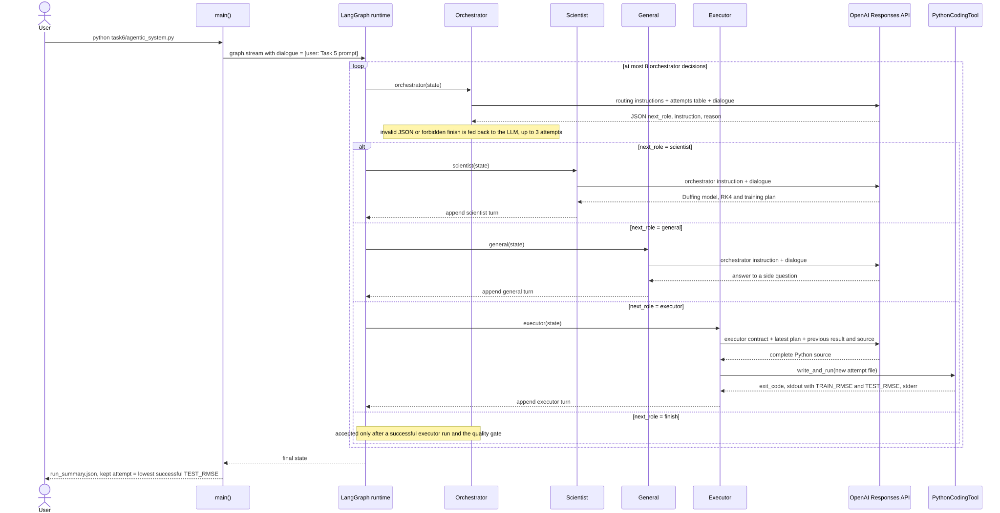
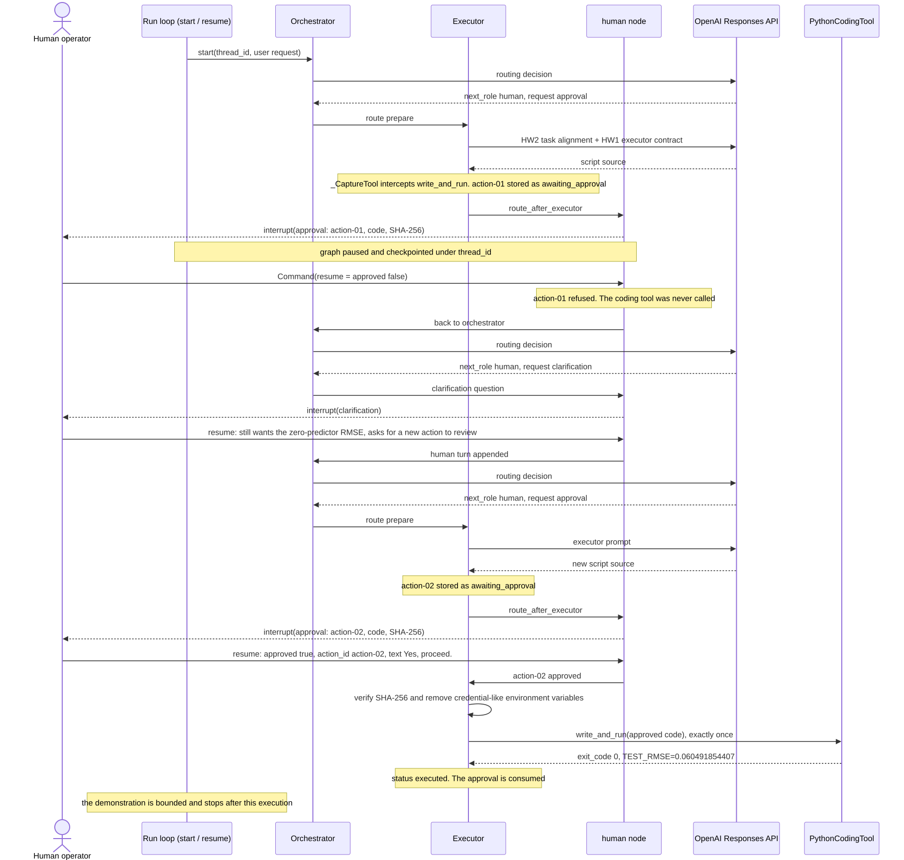
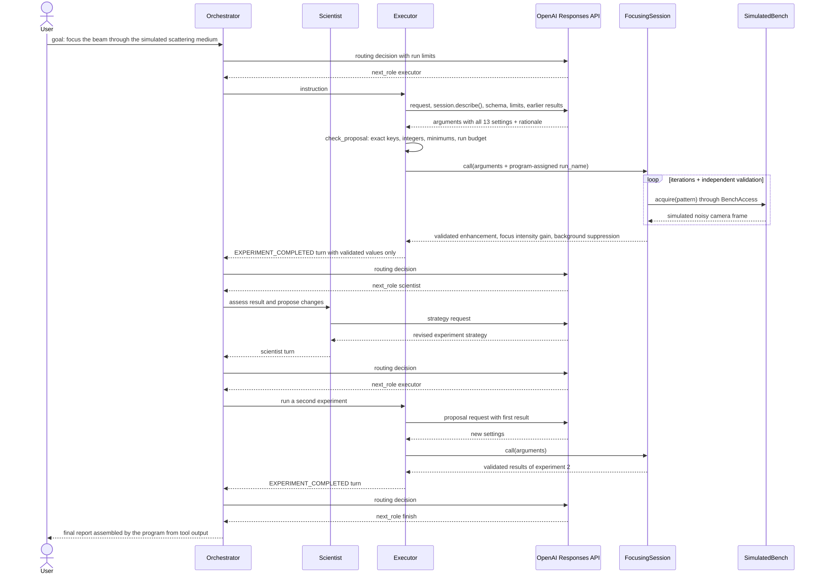
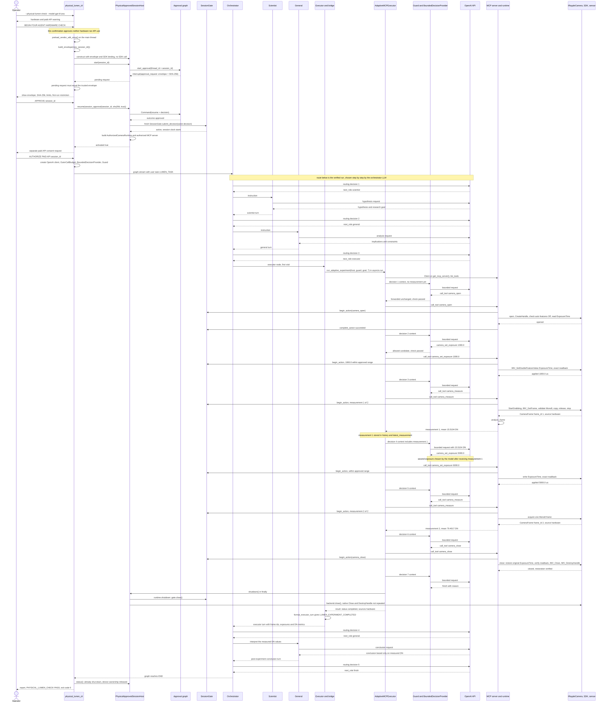

# PhotonicsAI Homework 3 — Hardware in the Loop

**LUMEN: Autonomous Lensless Measurement & Experimentation Network**

**Author:** Alexander Hajoyan
**Assignment:** PhotonicsAI — Homework 3 — Hardware in the Loop
**System:** LUMEN, the HW1 four-agent LangGraph system extended to a physical camera
**Hardware:** iRAYPLE MV-A7200MU130 USB3 monochrome camera, no lens attached, controlled through
the vendor's HuaRay IMV SDK
**Report date:** 2026-10-15

> **GitHub repository URL:** <https://github.com/aleksandrhajoyan/PhotonicsAI-HW3-4-beta>
>
> **Editorial note (remove before PDF export).** The demonstration videos are delivered as
> assets of a GitHub Release of this repository; their download links are still pending and will
> be added once the Release exists (Section 18.3). This Markdown is the source for the final PDF
> and must not be exported or submitted until the repository contents and the Release have been
> checked and this note is updated.

**Evidence policy.** Every number in this report comes from one of the sources below. The report
states which source applies to each claim.

- **Terminal report:** the operator's recorded terminal output of a physical run.
- **Video:** frames independently inspected in the submitted screen recordings.
- **Source:** the source code in this repository.

Nothing was re-run for this report. No run log, image or raw frame from the physical runs is stored
in the repository, because the physical command-line programs are designed to save nothing.

**Grading basis.** This report follows the official assignment *PhotonicsAI — Homework 3 —
Hardware in the Loop*. Its Task 1 has six graded components, (a)–(f), worth 4 + 4 + 4 + 4 + 4 + 6
= 26 possible points. Section 2 maps each component to the implementation, the physical evidence,
the figures and the relevant report section. The mapping describes coverage only; it does not
claim that any points have been awarded.

---

## 1. Executive summary

LUMEN connects the unchanged HW1 four-role multi-agent system (Orchestrator, Scientist, General,
Executor) to a real physical instrument: a lensless iRAYPLE MV-A7200MU130 monochrome camera,
controlled through the vendor's HuaRay IMV SDK.

**How the system is built:**

- A **connector**, `IRaypleCamera` (`hw3/irayple_camera.py`), drives the camera through the
  documented HuaRay IMV SDK Python binding (`IMVApi`).
- A Model Context Protocol (MCP) **server** exposes the camera as a small set of tools. Every tool
  call uses the real connector.
- Every tool call passes through a fail-closed authorization gate (`SessionGate`). The gate
  enforces a session envelope that a human approved, and the envelope is bound by SHA-256.
- The HW1 **Executor** is the only agent that holds the hardware tools. A language model
  (`gpt-6-luna`) chooses each physical action, one decision at a time, after seeing the measured
  results of the previous actions.
- Trusted code, not the model, enforces every physical limit.

**Three physical experiments (use cases) were carried out:**

| ID | Experiment | Verdict |
|---|---|---|
| **D4** | Fixed six-call MCP diagnostic (no AI) | `PHYSICAL_MCP_CHECK: PASS` (terminal report) |
| **D5A** | LLM-driven adaptive MCP experiment | `PHYSICAL_ADAPTIVE_CHECK: PASS`, exit code 0 (terminal report and video) |
| **D6A** | Full four-agent LUMEN run on the camera | `PHYSICAL_LUMEN_CHECK: PASS`, exit code 0 (terminal report and video) |

**Results:**

- Each experiment acquired two real 1920 × 1200 Mono8 frames from the sensor, at 1000 µs and
  5000 µs, with no saturated pixels.
- In D5A and D6A, the model chose the second exposure **after** it had received measurement 1.
- The camera's original exposure was restored and verified at the end of every run.
- All values are **raw, uncalibrated digital numbers (DN)** recorded under uncontrolled ambient
  light. No optical focus, calibration or linearity is claimed.

---

## 2. Official HW3 requirements coverage

The table maps each graded component of HW3 Task 1 to where it is implemented and evidenced. The
point values are those stated in the assignment; no points are claimed as awarded.

| Criterion (points) | Requirement | Implemented source components | Real experiment evidence | Figures | Report section |
|---|---|---|---|---|---|
| **(a) Connector** (4) | Connect to real hardware through the instrument's documented SDK/API; name the instrument and interface | **Instrument:** iRAYPLE MV-A7200MU130 USB3 monochrome camera. **Interface:** HuaRay IMV SDK, Python binding `IMVApi` (`IMV_CreateHandle`, `IMV_SetDoubleFeatureValue`, `IMV_GetFrame`, `IMV_DestroyHandle`, …), loaded by `hw3/irayple_discovery.py`. **Connector:** `IRaypleCamera` in `hw3/irayple_camera.py` (a `CameraBackend`) | D4, D5A, D6A: two real 1920 × 1200 Mono8 frames each, labelled `source=hardware`; exposure writes read back exactly; original `ExposureTime` restored and verified. Earlier bring-up screenshots (Section 14) | 6, 8 | 4, 7 |
| **(b) MCP server** (4) | Expose actual hardware controls or measurements as MCP tools that use the real connector | `hw3/authorized_mcp.py` (official MCP SDK `MCPServer`; tools `camera_info`, `camera_open`, `camera_set_exposure`, `camera_measure`, `camera_close`) → `hw3/authorized_camera.py` (`AuthorizedCameraRuntime`) → `IRaypleCamera`. `hw3/physical_approved_session_host.py` binds the server to the real connector | All three runs: 6 authorized MCP calls each, through the official MCP `Client`, all reaching the physical camera (Section 8.2 lists what the instrument does for each tool) | 6, 7, 8 | 8 |
| **(c) One agent holds tools** (4) | One of the original HW1/HW2 agents holds hardware tools; its tool calls are selected by the model from the dialogue | The original HW1 **Executor** (`LumenAgentSystem` in `hw3/lumen_agent_system.py`, subclass of HW1 `AgenticSilverboxSystem`) is the only role that can reach the camera. The Orchestrator model selects the Executor from the dialogue; the Executor's hardware model selects every MCP call (`AdaptiveMCPExecutor` in `hw3/executor_mcp_loop.py`, validated by `parse_decision`) | D6A: the Executor, chosen by the Orchestrator, made 7 model decisions and 6 model-selected MCP calls. D5A: the same hardware loop on its own | 6, 7, 8 | 6, 11.3 |
| **(d) Hardware in the loop** (4) | The graph dispatches the hardware turn; the agent chooses a command, the instrument acts, the measurement enters the dialogue, and a following model decision uses it | The HW1 graph routes `orchestrator → executor`; the Executor node dispatches once through `hw3/executor_dialogue_bridge.py`. Inside the turn, `latest_measurement` is returned to the model before its next decision. `format_executor_turn()` writes the measured DN into the shared dialogue as a `LUMEN_EXPERIMENT_COMPLETED` turn | D5A and D6A: decision 4 chose `camera_set_exposure(5000.0)` **after** measurement 1 (16.0118 DN / 15.5104 DN) was in the model's input. D6A: after the Executor's turn, the Orchestrator routed to **General**, which wrote the conclusion from the measured DN | 7, 8 | 6, 11.2, 11.3 |
| **(e) Diagrams** (4) | Whole-system architecture diagram covering HW1's four roles, HW2's human stop and simulated bench, and HW3's connector, MCP server and hardware turn; sequence diagrams of the runs | Mermaid sources in `hw3/docs/system_diagrams.md`, rendered to SVG in `hw3/docs/figures/` | Figure 7 follows the recorded D6A run; Figures 4 and 5 follow recorded HW2 runs | **8** (whole system), 1–7 | 5, 13 |
| **(f) Use cases and demo** (6) | Several use cases, each with the request, the agent's tool calls and the actual instrument response; a recorded demo of model choice, MCP call and hardware response | `hw3/physical_mcp_smoke.py` (D4), `hw3/physical_adaptive_cli.py` (D5A), `hw3/physical_lumen_cli.py` (D6A) | Three physical use cases with measured DN (Section 11). Videos `HW3_02_Adaptive_LLM_D5A.mp4` and `HW3_03_Four_Agent_LUMEN_D6A.mp4` show model decisions, MCP calls and hardware responses; `HW3_01_Physical_MCP_D4.mp4` shows the fixed MCP path (operator-confirmed) | 7 | 11, 12, 18.3 |

**Precision note on criterion (c).** The Executor's *dispatch* is selected by the Orchestrator
model from the shared dialogue. Each individual *MCP call* is selected by the Executor's hardware
model from a JSON context containing the trusted research goal, the tool schemas, the event
history of that hardware turn and the latest measurement. The hardware model does not receive the
free-text outer dialogue, and nothing in the dialogue grants tool access (Section 6).

---

## 3. HW3 objectives and scope

| Objective | How LUMEN addresses it |
|---|---|
| **Autonomous experimentation** | The research goal is given in natural language. The agents decide the route (D6A), and the hardware model decides each tool call and when to finish (D5A, D6A) |
| **Hardware in the loop** | Real Mono8 frames from a physical sensor feed back into the next model decision. Every frame carries the provenance label `source=hardware` |
| **Genuine model-directed physical actions** | In D5A and D6A, every MCP camera call (`camera_open`, `camera_set_exposure`, `camera_measure`, `camera_close`) was chosen by the model. Nothing is substituted or repaired by the program |
| **Human approval and bounded execution** | Three typed human gates. A LangGraph approval of the exact session envelope. Hard limits on exposure, number of measurements, number of tool calls and session duration. Fail-closed cleanup |

**Out of scope:** optical imaging (no lens), photometric calibration, and optimisation beyond a
two-value exposure choice in this first-run protocol.

---

## 4. Hardware and software environment

| Component | Details |
|---|---|
| Camera | iRAYPLE MV-A7200MU130 (vendor name "Machine Vision"), USB3, area-scan monochrome sensor |
| Frame format | 1920 × 1200 pixels, Mono8 (8-bit, pixel format `0x01080001`), unpadded, 2,304,000 bytes per frame |
| Optics | **No lens attached** (lensless sensor exposed to ambient light) |
| Vendor SDK (connector interface) | HuaRay IMV SDK through its Python binding (`IMVApi`; calls such as `IMV_CreateHandle`, `IMV_SetDoubleFeatureValue`, `IMV_GetFrame`, `IMV_DestroyHandle`) |
| Vendor GUI (pre-checks only) | MV Viewer. Used by the operator to confirm the device, `ExposureAuto Off`, `TriggerMode Off`, the original `ExposureTime 5000 µs` and the microsecond unit. **It is not part of the LUMEN control path** |
| Language / runtime | Python, in a dedicated user-local virtual environment (`%LOCALAPPDATA%\LUMEN\hw3-venv`) |
| Agent framework | LangGraph (`StateGraph`, `interrupt()`, `Command(resume=...)`, `InMemorySaver`) |
| Tool protocol | Official MCP Python SDK: `MCPServer` for the server and the in-memory MCP `Client` |
| Language model | OpenAI Responses API, model `gpt-6-luna`. The client has `max_retries=0` and a 30 s timeout |
| Numerical | NumPy, for in-memory DN statistics |
| Operating system | Windows 11 |

The exposure unit (µs) is not stated by the installed SDK headers. It was confirmed by the
operator in MV Viewer, and the code records that confirmation (`irayple_exposure_sweep
--unit-us-verified`).

**Unit of the measurement.** The sensor returns uncalibrated 8-bit Mono8 values. A **digital
number (DN)** is the raw integer pixel value, 0–255. DN is not converted to photons, electrons or
irradiance anywhere in this work.

---

## 5. System architecture: HW1 → HW2 → HW3

All three homeworks share one class, `AgenticSilverboxSystem` in `task6/agentic_system.py`. Later
homeworks **subclass** it and never modify it.

| Homework | What the four roles control | Executor's capability | Human role | Physical hardware |
|---|---|---|---|---|
| **HW1** (Tasks 5/6) | Silverbox nonlinear-oscillator modelling (neural network + RK4 free run) on a recorded benchmark (`SNLS80mV.mat`) | `PythonCodingTool`: writes and runs a new Python script (300 s timeout) | None | **None.** Recorded data |
| **HW2 Task 1** | The same Silverbox work, plus a model-selected `human` destination | The same coding tool, run only after the human approves the exact SHA-256-bound action | LangGraph `interrupt()` / `Command(resume=...)` for clarification and approval | **None** |
| **HW2 Task 2** | Wavefront shaping through a scattering medium | `FocusingSession.call(arguments)`, one bounded experiment | None | **None. Fully simulated:** the DMD, transmission matrix and camera noise come from `hw2/simulated_bench.py` |
| **HW3** (LUMEN) | Exposure experiment on a real sensor | A single dispatch, through a bridge, to an adaptive MCP executor whose LLM picks each camera tool call | Typed confirmation, LangGraph session approval and separate paid-API consent | **Yes.** The iRAYPLE MV-A7200MU130 through the HuaRay IMV SDK |

**Simulated versus physical.** HW2 Task 2 is a software simulation, and its "camera images" are
generated numerically. HW3 is the first and only homework in which a physical device was
controlled. The HW1 PINN/Silverbox task is a numerical modelling task on recorded data and shares
no hardware path with HW3.

### 5.1 Figure 8 — Integrated whole-system architecture



**Figure 8 — Integrated HW1/HW2/HW3 system architecture.** Rendered SVG:
[`hw1_hw2_hw3_overview.svg`](../hw3/docs/figures/hw1_hw2_hw3_overview.svg); Mermaid source and
full source traceability: [`hw3/docs/system_diagrams.md`](../hw3/docs/system_diagrams.md) §9.

What Figure 8 covers, as required by criterion (e):

| Required element | Where it appears in Figure 8 |
|---|---|
| HW1's four roles | HW1 block: Orchestrator, Scientist, General, Executor with `PythonCodingTool`, in the base class `AgenticSilverboxSystem` |
| HW2's human stop | HW2 Task 1 block: **HUMAN STOP: code approval** (`interrupt()` / `Command(resume=...)`, SHA-256-bound action) |
| HW2's simulated bench | HW2 Task 2 block: `SimulatedBench`, marked **SIMULATION ONLY** (yellow, dashed) |
| HW3's connector | `IRaypleCamera` connector → official HuaRay IMV SDK → real MV-A7200MU130 (green) |
| HW3's MCP server | Official MCP SDK `Client` → authorized MCP server (5 camera tools) → `AuthorizedCameraRuntime` → `SessionGate` |
| HW3's hardware turn | Executor `==> HARDWARE TURN` → `executor_dialogue_bridge` → `AdaptiveMCPExecutor`, with the measurement feedback edge and the `LUMEN_EXPERIMENT_COMPLETED` turn back to the Executor |
| HW3's human stop | **HUMAN STOP: hardware approval** of the SHA-256-bound `SessionEnvelope` |

**How to read Figure 8.** It shows **architectural evolution**, not a runtime in which the three
applications execute together. HW1 is the common origin. HW2 Task 1, HW2 Task 2 and HW3 are three
*separate* applications, each started on its own, that subclass the HW1 class. Dashed arrows from
the base class denote inheritance, not data flow. The applications share no session, approval or
hardware, and the HW2 simulated bench is not connected to the HW3 camera. Human-stop nodes are
orange, simulated components are yellow with dashed borders, and physical hardware components are
green. Figure 8 adds no new experimental claim.

> **Layout note for PDF export.** Figure 8 is very tall (SVG view box about 1964 × 4749 units,
> aspect ratio about 1 : 2.4). It needs a dedicated full page, either a large-format page or a
> landscape page with the figure rotated, so that its labels stay legible. It must not be
> downscaled to fit a portion of a normal page.

---

## 6. HW3 four-agent architecture

`LumenAgentSystem` (`hw3/lumen_agent_system.py`) extends the HW1 class in the same way as the HW2
`FocusingAgentSystem`:

- The HW1 constructor is not called. The model caller is injected, and the HW1 coding tool is
  disabled (`coding_tool = None`).
- The inherited `build()` keeps the HW1 topology:

  `START → orchestrator → scientist | general | executor → orchestrator → … → finish → END`

- The HW1 limit of `MAX_DECISIONS = 8` orchestrator decisions is kept unchanged.

| Role | Behaviour in LUMEN | Tools |
|---|---|---|
| **Orchestrator** | One model call per decision. The reply must be exactly `{"next_role", "instruction", "reason"}`. Anything else raises `RoutingError`: no retry, no turn appended, nothing executed | None |
| **Scientist** | Model-written hypothesis or research reasoning | None |
| **General** | Model-written analysis of implications and the post-experiment conclusion | None |
| **Executor** | On its **first** visit, calls `run_adaptive_experiment()` **once** with trusted values only (host, decision provider, research goal, budget). A second visit is refused without any dispatch | **The only role that can reach the camera** |

**Bridge to the adaptive executor** (`hw3/executor_dialogue_bridge.py`):

- `run_adaptive_experiment()` runs `AdaptiveMCPExecutor` with `asyncio.run()`.
- `format_executor_turn()` turns its structured result into a single bounded dialogue turn. The
  turn begins with `LUMEN_EXPERIMENT_COMPLETED` only when all of these hold:
  - the status is `completed`
  - at least one measurement succeeded
  - the shutdown was clean
  - the provenance labels are consistent
- Untrusted strings are sanitised and length-capped.

**LLM-selected MCP commands** (`hw3/executor_mcp_loop.py`):

1. `AdaptiveMCPExecutor` opens an official MCP `Client` on the approved server and lists its tools.
2. It sends the hardware model a JSON context: research goal, tool schemas, event history, latest
   measurement and remaining decision budget.
3. The model replies with exactly one action: `{"action": "call_tool", "tool": …, "arguments": …}`
   or `{"action": "finish", "reason": …}`.
4. The decision is strictly validated (`parse_decision`), then exactly that one MCP call is made.
   Nothing is repaired, clipped or coerced.
5. Any failure stops the run without retrying.

**The hardware turn (criterion d).** In D6A the loop is closed at two levels:

1. *Inside the hardware turn:* the instrument's measurement is returned to the hardware model as
   `latest_measurement` before its next decision, which is how decision 4 chose the second
   exposure after measurement 1.
2. *In the agent dialogue:* the measured DN enter the shared dialogue as the Executor's
   `LUMEN_EXPERIMENT_COMPLETED` turn. The Orchestrator's next decision then routes to General,
   whose conclusion uses those values.

**Nothing in the dialogue grants authority.** No turn text is parsed for approval or tool access.
Hardware approval happens entirely outside the agent graph.

---

## 7. Physical camera integration (connector)

All of the following is implemented in `hw3/irayple_camera.py` and
`hw3/physical_approved_session_host.py`.

- **SDK discovery and preload.**
  - `preload_vendor_sdk_once()` loads the vendor binding exactly once per process, on the main
    thread, before any event loop exists or any MCP tool is served. The loader briefly changes the
    working directory, so it must never run inside a tool handler.
  - It refuses to load while a physical session host exists.
  - Constructing `IRaypleCamera` makes no SDK call.
- **`IRaypleCamera` as a `CameraBackend`.**
  - `open()` enumerates USB3 devices and requires exactly one MV-A7200MU130. It creates the handle,
    opens the camera and requires `TriggerMode`, `ExposureAuto` and `GainAuto` to read `Off`.
  - It also reads and validates the current, minimum and maximum `ExposureTime`.
  - `open()` performs no feature write and no grabbing.
- **Mono8 acquisition.** `capture_frame()` does the following, and returns a `CameraFrame` labelled
  `source=hardware` only if every step succeeded:
  1. `StartGrabbing`
  2. one `IMV_GetFrame` with a bounded timeout, never retried
  3. validation of an unpadded Mono8 layout
  4. a copy into NumPy-owned memory
  5. `ReleaseFrame` once, then `StopGrabbing`
- **Exposure write with exact readback.**
  - `set_exposure_us()` re-checks the `Off` features and marks restoration as required.
  - It writes `ExposureTime` with `IMV_SetDoubleFeatureValue` and reads it back. The readback must
    equal the request exactly; nothing is clamped, rounded or retried.
- **Restoration on close.**
  - If any write was attempted, `close()` restores and verifies the original `ExposureTime`, then
    calls `Close` and `DestroyHandle`.
  - Failures raise `IRaypleCloseError` and are never reported as clean.
- **Exclusive ownership.**
  - At most one `PhysicalApprovedSessionHost`, and therefore one `IRaypleCamera`, can exist per
    process.
  - Ownership is released only after a successful backend release. After a failed cleanup the
    device stays claimed and the process must be restarted.
  - Every SDK-touching method holds a non-blocking lock, so overlapping calls are rejected rather
    than queued.
- **DN statistics.** `hw3/measurements.py` (`analyze_frame`) computes `mean_dn`, minimum, maximum
  and `saturation_fraction` (pixels equal to 255) in memory. No frame is written to disk.

---

## 8. MCP integration (server)

### 8.1 Layers

| Layer | File | Responsibility |
|---|---|---|
| MCP server | `hw3/authorized_mcp.py` | Defines five tools on the official MCP SDK (`camera_info`, `camera_open`, `camera_set_exposure(exposure_us)`, `camera_measure`, `camera_close`). Each handler makes exactly one call, `runtime.execute(action_id, tool, arguments)`. The `action_id` is issued by the server (`mcp-<uuid4>-<n>`) and cannot be supplied by a client |
| Runtime | `hw3/authorized_camera.py` (`AuthorizedCameraRuntime`) | Calls `gate.begin_action(...)` first; a refused call never reaches the backend. Then exactly one backend operation runs, then `gate.complete_action(...)`. Any failure after authorization is marked **ambiguous**, which aborts the session and triggers `shutdown()` |
| Policy | `hw3/session_policy.py` (`SessionEnvelope`, `SessionGate`) | An immutable envelope and a state machine: `awaiting_approval → active → exhausted / expired / aborted / closed / refused`. Only `active` authorizes actions. Budget is reserved before an action and never refunded. One action may be in flight at a time. Every `action_id` is single-use |
| Client | `hw3/executor_mcp_loop.py` | The official MCP `Client` used by `AdaptiveMCPExecutor` |

### 8.2 What the instrument does for each MCP tool

From `hw3/authorized_camera.py` and `hw3/irayple_camera.py`:

| MCP tool | Physical action by the instrument (through `IRaypleCamera` and the HuaRay IMV SDK) | Returned to the caller | Used in the physical runs |
|---|---|---|---|
| `camera_open` | Enumerate USB3 devices, require exactly one MV-A7200MU130, create the handle and open the device; check `TriggerMode`, `ExposureAuto`, `GainAuto` are `Off`; read `ExposureTime` and its limits. No feature write, no grabbing | `ok`, `is_open: true` | Yes (call 1) |
| `camera_set_exposure(exposure_us)` | Write `ExposureTime` with `IMV_SetDoubleFeatureValue` and read it back; the readback must equal the request exactly | applied `exposure_us` | Yes (calls 2 and 4) |
| `camera_measure` | `StartGrabbing`, one `IMV_GetFrame`, Mono8 layout check, copy to NumPy, `ReleaseFrame`, `StopGrabbing`; then `analyze_frame` in memory | `source`, `frame_id`, `exposure_us`, `bit_depth`, `width`, `height` and `metrics` (`mean_dn`, `min_dn`, `max_dn`, `saturation_fraction`, percentiles, histogram, …). Raw pixels are **not** returned | Yes (calls 3 and 5) |
| `camera_close` | Restore and verify the original `ExposureTime` if it was written, then `Close` and `DestroyHandle` | `ok`, `is_open: false` | Yes (call 6) |
| `camera_info` | Describe the backend and its exposure limits | backend info and limits | **No.** Not in the approved envelope |

### 8.3 Session envelope

**Envelope used in all three physical experiments:**

- tools `camera_open`, `camera_set_exposure`, `camera_measure`, `camera_close` (`camera_info` is
  **not** allowed)
- exposure 1000–5000 µs
- at most 2 measurements and 7 tool calls
- at most 180 s

It is built by trusted code (`physical_mcp_smoke.build_envelope`) and must lie inside
`PHYSICAL_LIMITS` (`physical_approved_session_host.py`).

**The model has no authority to bypass the policy:**

- It cannot supply an `action_id`.
- It cannot widen the envelope or approve a session.
- It cannot call a tool outside the envelope.
- `parse_decision` rejects fields the model must not control.
- `SessionGate` independently checks every call, even one the guard has passed.

---

## 9. Human-in-the-loop and safety

The three physical programs share the same trust chain, implemented in `physical_mcp_smoke.py`,
`physical_adaptive_cli.py` and `physical_lumen_cli.py`:

1. **Explicit invocation.**
   - A required flag (`--physical-mcp-check`, `--physical-adaptive-check` or
     `--physical-lumen-check`).
   - An explicit `--model` for the AI runs; there is no default model.
   - An interactive terminal.
   - Without all of these, nothing is loaded.
2. **Initial operator confirmation.** A typed phrase is required: `BEGIN PHYSICAL MCP CHECK`,
   `BEGIN ADAPTIVE HARDWARE CHECK` or `BEGIN FOUR AGENT HARDWARE CHECK`. This confirmation does
   **not** approve hardware access.
3. **LangGraph approval of the exact session envelope** (`hw3/hitl_approval.py`).
   - A real `START → hardware_approval → END` graph pauses at `interrupt()` and shows the canonical
     envelope JSON with its **SHA-256**.
   - The human must type exactly `APPROVE <session_id>` within 120 s.
   - Only `{"approved": true, "session_id": <exact>, "envelope_sha256": <exact>}` approves. Anything
     else, including an empty or late answer, is a refusal.
   - Activation requires **both** the approval graph **and** a fresh execution-side `SessionGate`
     to accept the same decision.
   - A finished approval thread cannot be replayed.
4. **Separate paid-API consent** (D5A and D6A only).
   - The human must type `AUTHORIZE PAID API <session_id>` within 60 s. Only then is the OpenAI
     client created.
   - Request limits:
     - D5A: at most 7 hardware decisions.
     - D6A: at most 16 outer-agent calls (`OuterCallBudget`) plus 7 hardware decisions.
   - There are no automatic retries and no fallback model. These call limits are not a monetary
     spending cap.
5. **Physical limits.**
   - Exposure is restricted to 1000–5000 µs, with at most 2 measurements, 7 tool calls and 180 s.
   - **Trusted first-run decision guard** (`FirstRunDecisionGuard` in `physical_adaptive_cli.py`).
     It never edits a decision. It forwards the model's reply unchanged or refuses it, which stops
     the run before any MCP call. It enforces:
     - exposure only **1000.0 or 5000.0 µs**
     - `camera_open` first
     - `camera_measure` only directly after a new exposure
     - nothing but `finish` after `camera_close`
   - Because of these rules, the second exposure decision can only be made after measurement 1 is
     in the model's input.
6. **Cleanup and fail-closed paths.**
   - `host.shutdown()` runs on every path, including success, refusal, tool or validation failure,
     expiry, `KeyboardInterrupt` and early return. It is never attempted twice after a failed
     cleanup.
   - Exit codes distinguish these outcomes (`physical_adaptive_cli.py`, also used by
     `physical_lumen_cli.py`; `physical_mcp_smoke.py` uses the subset that applies without an
     LLM):

     | Code | Meaning |
     |---|---|
     | 0 | PASS |
     | 1 | FAIL |
     | 2 | Usage error or confirmation refused |
     | 3 | Not interactive |
     | 4 | Approval refused |
     | 5 | INCOMPLETE |
     | 6 | Cleanup failure |
     | 7 | API consent refused |
     | 130 | Interrupted |

   - **Known limitation:** a forcibly killed process cannot restore `ExposureTime`. The programs
     state this and advise checking it in MV Viewer.

**Fail-closed approval (code behavior).** The approval check is an exact string comparison
(`approved = line == phrase` in `physical_mcp_smoke.py`). Any other input is refused with `REFUSED:
input did not match the approval phrase (no retry)`, including a line with an extra leading space,
`DENY`, end of input or a late answer. A refused session issues no MCP call, writes no exposure and
still runs the trusted shutdown.

This paragraph describes software behavior established from the source code. It is not one of the
three recorded physical experiments.

---

## 10. Experimental methodology

**Three distinct experiments.** Each experiment ran in its own process with a fresh, separately
approved session envelope and a fresh `session_id`. They were run as separate experiments under the
same software protocol, not as repeated trials of one experiment.

| Experiment | Who chooses the actions |
|---|---|
| D4 | A fixed script |
| D5A | An LLM |
| D6A | An LLM inside the four-agent graph |

**Controlled software protocol.** All runs used:

- the same envelope limits
- the same two candidate exposures (1000 µs and 5000 µs)
- the same open → (set → measure) ≤ 2 → close structure
- the same in-memory DN analysis

**Requests given to the AI runs** (quoted verbatim from the source):

- **D5A hardware model**, and the **D6A Executor's hardware model**
  (`RESEARCH_GOAL` in `hw3/physical_adaptive_cli.py`; reused as `HARDWARE_GOAL` in
  `hw3/physical_lumen_cli.py`):

  > Use a lensless monochrome camera to obtain at most two physical measurements under constant
  > ambient illumination. Aim for a mean digital signal near 70 DN without saturation. Choose
  > exposure based on earlier measured statistics. Report raw digital numbers only.

  This is also the text the D5A program printed on screen, as seen in the video. The D6A Executor
  goal displayed in its video has the same wording.

- **D6A four-agent task**, the first user turn of the shared dialogue (`LUMEN_TASK` in
  `hw3/physical_lumen_cli.py`):

  > Coordinate a scientific lensless-camera experiment. Have the relevant scientific and
  > general-purpose agents assess the objective and safety constraints. The Executor must use the
  > approved physical MCP tools to obtain at most two real Mono8 measurements and adapt exposure
  > using the first measurement. Aim for a mean near 70 DN without saturation. Produce a concise
  > conclusion based only on measured digital numbers.

**Measured quantity.** For each frame, the mean, minimum and maximum of the raw 8-bit values over
the full 1920 × 1200 frame, and the fraction of pixels equal to 255.

**Raw, uncalibrated DN.** The physical sensor returns uncalibrated Mono8 digital numbers. No
dark-frame subtraction, flat-field correction or gain calibration was applied.

**Ambient illumination.** The sensor was exposed to uncontrolled room light, which was neither
measured nor stabilised. The three experiments were run at different times. Their absolute DN
values therefore **cannot be compared as sensor properties**; only within-run behaviour is
interpreted.

---

## 11. Use cases: the three physical experiments

Each use case below starts with a structured summary (request, model role, MCP calls, instrument
response, evidence, limitation), followed by the detailed record.

### 11.1 Use case D4: fixed physical MCP diagnostic

| Item | D4 |
|---|---|
| **1. Request / objective** | Verify that the authorized MCP server can operate the physical camera end to end, through `SessionGate` and `IRaypleCamera`, with a fixed, transparent call sequence. There is no natural-language request; the operator starts the program |
| **2. Agent / model role** | **None. Not LLM-driven, not model-selected.** A fixed script (`hw3/physical_mcp_smoke.py`) issues the calls through the official MCP `Client`. No API use, no network access |
| **3. MCP tool calls, in order** | 6 fixed calls: `camera_open` → `camera_set_exposure(1000.0)` → `camera_measure` → `camera_set_exposure(5000.0)` → `camera_measure` → `camera_close` |
| **4. Instrument response** | Two 1920×1200 Mono8 hardware frames. 1000 µs: mean **10.9139 DN** (min 6, max 14), saturation 0. 5000 µs: mean **56.6203 DN** (min 32, max 70), saturation 0. Exposure restoration verified |
| **5. Evidence and outcome** | Earlier operator terminal report: `PHYSICAL_MCP_CHECK: PASS`. Video `HW3_01_Physical_MCP_D4.mp4` is an operator-confirmed successful D4 run, not independently inspected, and is not claimed to show these exact values |
| **6. Limitation** | Demonstrates the physical MCP path and cleanup only. It does **not** demonstrate model control |

**Program:** `hw3/physical_mcp_smoke.py --physical-mcp-check`. **Not LLM-driven**, with no API use
and no network access.

**Protocol.**

1. The operator types the confirmation `BEGIN PHYSICAL MCP CHECK`.
2. The operator approves the session envelope (HITL).
3. A fixed script issues exactly six authorized MCP calls through the official MCP `Client`:
   1. `camera_open`
   2. `camera_set_exposure(1000.0)`
   3. `camera_measure`
   4. `camera_set_exposure(5000.0)`
   5. `camera_measure`
   6. `camera_close`

**Table 11.1 — D4 results (terminal report).**

| Measurement | Exposure | Format, source | Mean DN | Min DN | Max DN | Saturation fraction |
|---|---|---|---|---|---|---|
| 1 | 1000 µs | 1920×1200 Mono8, hardware | 10.9139 | 6 | 14 | 0 |
| 2 | 5000 µs | 1920×1200 Mono8, hardware | 56.6203 | 32 | 70 | 0 |

- Mean difference: **+45.7064 DN**
- 6 MCP calls
- Exposure restoration verified
- **`PHYSICAL_MCP_CHECK: PASS`**

**Video evidence.** `HW3_01_Physical_MCP_D4.mp4` is, according to the operator, a recording of a
successful D4 physical MCP run. The operator replaced an earlier unsuccessful recording with this
file.

- **Not re-inspected.** The contents of the current file were not independently inspected for
  this report.
- **Provenance of the numbers.** The values in the table above come from the operator's earlier
  successful D4 terminal report. The recording may show a different successful D4 run, so it is
  not claimed to contain these exact values.

**What D4 proves.** The gated physical MCP path works end to end on real hardware:

`MCP Client → authorized server → AuthorizedCameraRuntime → SessionGate → IRaypleCamera → Mono8 frames`

It also verifies restoration. It does **not** demonstrate model control.

### 11.2 Use case D5A: adaptive LLM experiment

| Item | D5A |
|---|---|
| **1. Request / objective** | The `RESEARCH_GOAL` quoted in Section 10: at most two measurements, aim for a mean near 70 DN without saturation, choose exposure from earlier measured statistics |
| **2. Agent / model role** | **Real LLM, model-selected actions.** `gpt-6-luna` makes every decision through `AdaptiveMCPExecutor`, one at a time; the trusted `FirstRunDecisionGuard` only passes or refuses each decision, never edits it. 7 model decisions |
| **3. MCP tool calls, in order** | 6 model-selected calls: `camera_open` → `camera_set_exposure(1000.0)` → `camera_measure` → `camera_set_exposure(5000.0)` → `camera_measure` → `camera_close`; then decision 7, `finish` (not an MCP call) |
| **4. Instrument response** | Applied exposures read back as 1000.0 and 5000.0 µs. Frame 1 at 1000 µs: mean **16.0118 DN** (min 11, max 20), saturation 0. Frame 2 at 5000 µs: mean **82.0136 DN** (min 59, max 96), saturation 0. `ExposureTime` restored and verified |
| **5. Evidence and outcome** | Terminal report and inspected video `HW3_02_Adaptive_LLM_D5A.mp4`. The decision to set 5000 µs (decision 4) followed measurement 1. `PHYSICAL_ADAPTIVE_CHECK: PASS`, exit code 0 |
| **6. Limitation** | Choice restricted to two candidate exposures; one feedback-driven correction; 70 DN approached, not reached; raw uncalibrated DN under ambient light |

**Program:** `hw3/physical_adaptive_cli.py --physical-adaptive-check --model gpt-6-luna`
(banner `HW3.7-D5A`, session `lumen-phys-fc6e0919ae5180e1864a56e805f2d54b`).

**Protocol.**

1. Three human gates: `BEGIN ADAPTIVE HARDWARE CHECK`, `APPROVE <session_id>` and
   `AUTHORIZE PAID API <session_id>`.
2. `AdaptiveMCPExecutor` then asks `gpt-6-luna` for one decision at a time, through
   `FirstRunDecisionGuard(BoundedDecisionProvider(LumenOpenAIModelCaller))`.

**Table 11.2a — D5A model decisions (video):** 7 decisions, each with `check: passed`.

| # | Model saw | Model chose |
|---|---|---|
| 1 | no measurements | `camera_open()` |
| 2 | no measurements | `camera_set_exposure(exposure_us=1000.0)` |
| 3 | no measurements | `camera_measure()` |
| 4 | **measurement 1** | `camera_set_exposure(exposure_us=5000.0)` |
| 5 | measurement 1 | `camera_measure()` |
| 6 | measurements 1, 2 | `camera_close()` |
| 7 | measurements 1, 2 | `finish` ("…The 5000 µs measurement had a mean of 82.01 DN with no saturation, closest to the 70 DN target among the measured exposures.") |

**Table 11.2b — D5A results (terminal report; values confirmed in the video).**

| Measurement | Exposure | Format, source | Mean DN | Min DN | Max DN | Saturation fraction |
|---|---|---|---|---|---|---|
| 1 (frame_id 1) | 1000 µs | 1920×1200 Mono8, hardware | 16.0118 | 11 | 20 | 0.000000 |
| 2 (frame_id 2) | 5000 µs | 1920×1200 Mono8, hardware | 82.0136 | 59 | 96 | 0.000000 |

**Feedback evidence (video):**

> decision 4 (event 7) was requested after measurement frame_id 1 (event 6, mean 16.0118 DN) was
> in its input and chose camera_set_exposure(5000.0); measurement frame_id 2 followed (event 10)

**Outcome (video):**

- 6 MCP calls, all `success`, with applied exposures read back as 1000.0 µs and 5000.0 µs
- `session state: closed before trusted shutdown`
- `ExposureTime restored and verified`
- `device ownership: released`
- **`PHYSICAL_ADAPTIVE_CHECK: PASS`**, `exit code: 0`

**API requests.** The terminal report records 7 paid requests, one per model decision. In the
video, 6 `HTTP/1.1 200 OK` request lines are visible before the summary replaces them on screen.
The 7 listed decisions are consistent with 7 requests.

**Video evidence.** `HW3_02_Adaptive_LLM_D5A.mp4`. Its content and SHA-256 are identical to the
earlier-inspected original `demo3 hw3 adaptive llm.mp4`.

**What D5A proves.** A language model selected every physical action on a real camera, and its
second exposure decision used the first physical measurement. The run contains one feedback-driven
correction, from 1000 µs to 5000 µs.

### 11.3 Use case D6A: full four-agent physical LUMEN

| Item | D6A |
|---|---|
| **1. Request / objective** | The four-agent `LUMEN_TASK` quoted in Section 10 (first dialogue turn); the Executor's hardware model receives the same `RESEARCH_GOAL` as D5A |
| **2. Agent / model role** | **Real LLM, model-selected actions, four original HW1 roles:** Orchestrator, Scientist, General, Executor, all `gpt-6-luna`. The Orchestrator model routed to the Executor; the Executor (the only role holding hardware tools) dispatched once into the adaptive loop, whose model selected every MCP call. 8 outer-agent calls and 7 hardware model decisions |
| **3. MCP tool calls, in order** | 6 authorized, model-selected calls: `camera_open` → `camera_set_exposure(1000.0)` → `camera_measure` → `camera_set_exposure(5000.0)` → `camera_measure` → `camera_close`; then hardware decision 7, `finish` |
| **4. Instrument response** | Frame 1 at 1000 µs: mean **15.5104 DN** (min 11, max 18), saturation 0. Frame 2 at 5000 µs: mean **79.4017 DN** (min 63, max 89), saturation 0. `ExposureTime` restored and verified |
| **5. Evidence and outcome** | Terminal report and inspected video `HW3_03_Four_Agent_LUMEN_D6A.mp4`. Decision 4 set 5000 µs after measurement 1. General concluded after the Executor. `PHYSICAL_LUMEN_CHECK: PASS`, exit code 0 |
| **6. Limitation** | Same as D5A, plus: the role order, the 8/7 call split and the General conclusion are from the terminal report only (not legible in the video) |

**Program:** `hw3/physical_lumen_cli.py --physical-lumen-check --model gpt-6-luna`
(banner `HW3.7-D6A`, session `lumen-phys-05d1fcac1270faecf49f4a4c0212a6f8`).

**Protocol.**

1. Three human gates: `BEGIN FOUR AGENT HARDWARE CHECK`, `APPROVE <session_id>` and
   `AUTHORIZE PAID API <session_id>`.
2. The trusted CLI streams the original HW1 graph via `LumenAgentSystem`.
3. The Executor dispatches once into the same adaptive hardware loop used by D5A.

**Agent visitation order (terminal report):**

`orchestrator → scientist → orchestrator → general → orchestrator → executor → orchestrator → general → orchestrator`

- All four original HW1 roles took part.
- After the Executor's hardware turn, **General** wrote the post-experiment scientific conclusion,
  based on the measured DN.
- The PASS verdict *requires* such a conclusion: `physical_lumen_cli.verdict()` returns
  `INCOMPLETE` if no Scientist/General conclusion follows the completed Executor turn.

**Model calls (terminal report):** 8 outer-agent calls plus 7 hardware Executor decisions,
15 requests in total. The video shows 15 `HTTP/1.1 200 OK` lines; the 8/7 split itself is visible
only in the terminal report.

**Hardware decisions (video):** the same 7-step structure as D5A, each with `check: passed`.
Decision 4 chose `camera_set_exposure(5000.0)` after measurement 1. Decision 7 was `finish` ("…The
5000 µs measurement gave a mean of 79.4 DN with no saturation; no further measurement is
allowed.").

**Table 11.3 — D6A results (terminal report; values confirmed in the video).**

| Measurement | Exposure | Format, source | Mean DN | Min DN | Max DN | Saturation fraction |
|---|---|---|---|---|---|---|
| 1 (frame_id 1) | 1000 µs | 1920×1200 Mono8, hardware | 15.5104 | 11 | 18 | 0.000000 |
| 2 (frame_id 2) | 5000 µs | 1920×1200 Mono8, hardware | 79.4017 | 63 | 89 | 0.000000 |

**Outcome (video):**

- 6 MCP calls, all `success`
- the feedback-evidence line for decision 4 (after measurement 1, mean 15.5104 DN)
- session closed before trusted shutdown
- `ExposureTime restored and verified`
- `device ownership: released`
- `PHYSICAL_ADAPTIVE_CHECK: PASS` followed by **`PHYSICAL_LUMEN_CHECK: PASS (four roles took part;
  two hardware measurements with a feedback-driven second exposure; verified shutdown)`**
- `exit code: 0`

**Video evidence.** `HW3_03_Four_Agent_LUMEN_D6A.mp4`. Its content and SHA-256 are identical to the
earlier-inspected original `demo1 hw3.mp4`.

The per-role turn list scrolled off-screen within one second and is not legible in the recording.
The role order and the General conclusion are therefore taken from the terminal report, supported
by the verdict logic in the source.

**What D6A proves.** The original HW1 multi-agent system can direct a real physical experiment. The
agents plan and interpret, the Executor alone acts through the approved MCP boundary, and the
conclusion is grounded in measured values. Figure 7 (Section 13) shows this run as a sequence
diagram.

---

## 12. Results and comparison

**Table 12.1 — Comparison of the three physical experiments.**

| Quantity | D4 (fixed) | D5A (LLM) | D6A (four-agent) |
|---|---|---|---|
| Action selection | Fixed script | `gpt-6-luna` | `gpt-6-luna` within the HW1 graph |
| Paid API requests | 0 | 7 | 8 outer + 7 hardware = 15 |
| MCP tool calls | 6 | 6 | 6 |
| Mean DN at 1000 µs (min–max) | 10.9139 (6–14) | 16.0118 (11–20) | 15.5104 (11–18) |
| Mean DN at 5000 µs (min–max) | 56.6203 (32–70) | 82.0136 (59–96) | 79.4017 (63–89) |
| Saturation fraction | 0 / 0 | 0 / 0 | 0 / 0 |
| Within-run mean DN ratio, 5000/1000 µs | 5.19 | 5.12 | 5.12 |
| Feedback-driven exposure choice | No (predetermined) | **1** (decision 4) | **1** (decision 4) |
| Restoration and shutdown | Verified | Verified | Verified |
| Verdict | PASS | PASS, exit 0 | PASS, exit 0 |
| Video recording | Yes (operator-confirmed successful run; not re-inspected) | Yes (inspected) | Yes (inspected) |

All DN values are raw, uncalibrated Mono8 digital numbers. The ratios in the table are computed
from the reported means for descriptive purposes only. They are not a linearity test (see
Section 15).

**What each experiment proves:**

- **D4:** the physical MCP control path and cleanup work without any AI.
- **D5A:** model-selected physical actions with measurement feedback.
- **D6A:** integration of the original four-agent system with physical, model-selected MCP
  execution and a measurement-grounded conclusion.

**One adaptation per run versus several independent runs.**

- D5A and D6A are **two independent adaptive experiments**, each with its own approval, session and
  model calls.
- **Each contains exactly one feedback-driven exposure correction** (1000 µs → 5000 µs). No single
  session contains two sequential corrections; the policy allows at most two measurements per
  session.
- Taken together, the evidence shows the feedback loop working **in two separate runs**, not
  iterative multi-step optimisation within one run.

In both AI runs the model correctly chose the exposure whose result was closer to the 70 DN target
(82.0 and 79.4 DN versus 16.0 and 15.5 DN). Neither run reached exactly 70 DN, because only two
exposure values were allowed.

---

## 13. HW1 / HW2 / HW3 diagrams

The Mermaid source of all eight figures is in
[`hw3/docs/system_diagrams.md`](../hw3/docs/system_diagrams.md). Every figure was drawn from the
source code, and the same document traces each component to its file. The figures were rendered
to SVG with Mermaid CLI 11.16.0.

| Figure | Title | Type | File |
|---|---|---|---|
| 1 | HW1 architecture: four-agent LangGraph Silverbox system (Tasks 5 and 6) | Architecture | [`hw1_architecture.svg`](../hw3/docs/figures/hw1_architecture.svg) |
| 2 | HW1 sequence: orchestrated dialogue with the coding tool | Sequence | [`hw1_sequence.svg`](../hw3/docs/figures/hw1_sequence.svg) |
| 3 | HW2 architecture: HITL code approval (Task 1) and **simulated** focusing (Task 2) | Architecture | [`hw2_architecture.svg`](../hw3/docs/figures/hw2_architecture.svg) |
| 4 | HW2 Task 1 sequence: recorded refusal, clarification and approval | Sequence | [`hw2_hitl_sequence.svg`](../hw3/docs/figures/hw2_hitl_sequence.svg) |
| 5 | HW2 Task 2 sequence: **simulated** focusing experiment | Sequence | [`hw2_simulation_sequence.svg`](../hw3/docs/figures/hw2_simulation_sequence.svg) |
| 6 | HW3 architecture: LUMEN on the physical iRAYPLE camera | Architecture | [`hw3_architecture.svg`](../hw3/docs/figures/hw3_architecture.svg) |
| 7 | HW3 sequence: four-agent physical run (D6A), with General after Executor | Sequence | [`hw3_sequence.svg`](../hw3/docs/figures/hw3_sequence.svg) |
| **8** | **Integrated HW1/HW2/HW3 whole-system architecture** | Whole-system architecture | [`hw1_hw2_hw3_overview.svg`](../hw3/docs/figures/hw1_hw2_hw3_overview.svg) — **embedded in Section 5.1**, not repeated here |

**Sequence diagrams of the HW3 runs.** Figure 7 follows the D6A run, which contains the complete
D5A hardware loop as its Executor turn (the same seven decisions and six MCP calls). D4 uses the
same MCP path with a fixed call list and is described in Section 11.1.

**Figure 1 — HW1 architecture.**


**Figure 2 — HW1 sequence.**


**Figure 3 — HW2 architecture (Task 2 is simulation only).**


**Figure 4 — HW2 Task 1 HITL sequence.**


**Figure 5 — HW2 Task 2 simulated focusing sequence.**


**Figure 6 — HW3 LUMEN architecture.**


**Figure 7 — HW3 four-agent physical sequence (D6A).**


> **Layout note for PDF export.** Figures 6 and 7 are also large (view boxes about 3721 × 3324 and
> 4613 × 5373 units). Like Figure 8, they should each receive a full page rather than be
> downscaled until their text is unreadable.

---

## 14. Verification and testing

- **Offline tests.** `hw3/tests/` contains 25 test modules with 1004 test functions. They use a
  mocked SDK binding, `FakeCamera` (labelled synthetic) and scripted decision providers.
  - **1004 passing offline tests.** The final pre-submission audit (HW3.10-D, 2026-10-15; a
    local audit record that is not published in the repository) ran the suite with
    `unittest discover -s hw3/tests`: 1004 run, 1004 passed, 0 failed, 0 errors, 0 skipped,
    exit code 0. This matches the earlier baseline of 1004 stated in
    `hw3/docs/system_diagrams.md` §7. The suite was run again on 2026-10-15, after `mcp` and
    `pydantic` were declared in `requirements.txt`: 1004 tests, `OK`, exit code 0.
  - The tests were not re-run specifically for this revision of the report.
- **Physical PASS evidence.**

  | Run | Evidence |
  |---|---|
  | D5A | `PHYSICAL_ADAPTIVE_CHECK: PASS`, exit code 0, terminal report and video |
  | D6A | `PHYSICAL_LUMEN_CHECK: PASS`, exit code 0, terminal report and video |
  | D4 | `PHYSICAL_MCP_CHECK: PASS`, from the terminal report. The recording is operator-confirmed and was not independently inspected |

  Every PASS verdict is computed by trusted code, not by the model.
  - D5A requires two validated hardware frames (frame_id 1 and 2), a second exposure chosen after
    measurement 1, `camera_close` by the model, `finish`, and verified shutdown.
  - D6A additionally requires all four roles and a post-measurement conclusion.
- **Model feedback evidence.** In both D5A and D6A, the program's `feedback evidence` line ties the
  decision that chose 5000 µs (decision 4, event 7) to the measurement already in the model's input
  (event 6). Both are visible in the videos.
- **Cleanup verification.** All three successful runs reported `ExposureTime` restored and
  verified, a clean host shutdown and released device ownership. D5A and D6A show this in the
  videos.
  - Before the physical runs, the operator also confirmed the original exposure (5000 µs) and the
    `Off` auto features in MV Viewer (local screenshot `exposure measurement unit.png`; see
    Section 18.4).
- **Earlier hardware bring-up** (local screenshots, before the MCP integration; see Section 18.4):
  - single-frame capture (`camera frame capture 1.png`)
  - `IRaypleCamera` backend smoke test: 1000 µs, mean 16.4857 DN, `SMOKE_TEST_STATUS: PASS`
  - two-frame exposure sweep: 16.1592 and 82.7912 DN, `SWEEP_STATUS: SUCCESS`
  - each with verified restoration and exit code 0

---

## 15. Scientific limitations

- **No objective lens.** The sensor is lensless, so no optical image is formed.
- **No demonstrated optical focus.** Nothing in HW3 measures or optimises focus. The HW2 focusing
  results are simulations.
- **No absolute irradiance calibration.** DN values are raw, uncalibrated 8-bit Mono8 numbers. No
  conversion to photons, electrons or irradiance, and no dark or flat-field correction, was
  performed.
- **No sensor linearity claim.** Two exposure points per run cannot establish linearity, and none
  is claimed. The within-run ratios of about 5.1–5.2 are descriptive only.
- **No controlled illumination.** Ambient light was neither measured nor stabilised and may have
  changed between and within runs. The differences between runs (for example, 10.9 versus 16.0
  versus 15.5 DN at 1000 µs) must not be read as calibrated comparisons.
- **Only two exposure candidates.** In these first-run protocols, the trusted guard limited the
  model to 1000 µs or 5000 µs inside the approved 1000–5000 µs envelope. The experiments
  demonstrate feedback-driven *selection*, not fine exposure optimisation, and the 70 DN target was
  approached but not reached.
- **One feedback-driven correction per adaptive run.** D5A and D6A each contain exactly one. No
  single session performs multiple sequential corrections.
- **Evidence gaps.**
  - The D4 recording is operator-confirmed but was not independently inspected. The D4 numbers
    come from the operator's terminal report.
  - The D6A role list and 8/7 call split are not legible in the video.
  - No run logs are stored, by design.
- **Crash limitation.** A forcibly killed process cannot restore `ExposureTime`.

---

## 16. Conclusion

LUMEN shows that the HW1 four-agent LangGraph system can be extended, without modifying its HW1
implementation, from numerical modelling (HW1) and simulated optics (HW2) to a **real physical
camera**. The extension uses a documented-SDK connector and an MCP tool boundary that is
human-approved and enforced by policy.

| Run | What it showed |
|---|---|
| D4 | The physical control path works with fixed commands |
| D5A | A language model can select every physical action and use a real measurement to choose the next exposure |
| D6A | The full four-agent team (Orchestrator, Scientist, General, Executor) can plan, execute through the single authorized Executor, and write a conclusion grounded in measured DN, with verified cleanup |

Throughout, the model chose the actions but never held authority. A human approved the exact
session envelope bound by SHA-256, and trusted code enforced:

- the exposure range and the candidate values
- the measurement, tool-call and time budgets
- the action order
- provenance
- cleanup

The scientific claims are deliberately narrow: two raw DN measurements per run under ambient
light, with one feedback-driven exposure correction in each of the two independent adaptive runs.

---

## 17. Code repository

**GitHub repository URL:** <https://github.com/aleksandrhajoyan/PhotonicsAI-HW3-4-beta>

The submission rules require the code to be pushed to GitHub and the URL to appear in the PDF.
This is the code repository for this report. Its HW3 package consists of the HW3 source code,
the offline tests, the documentation, the eight SVG diagrams and this report, together with the
HW1 and HW2 code it builds on. The demonstration
videos are delivered as GitHub Release assets (Section 18.3); their links are pending until the
Release exists.

---

## 18. Reproducibility and evidence index

### 18.1 Source files

| Area | Files |
|---|---|
| HW1 base system (unchanged) | `task6/agentic_system.py` |
| Four-agent LUMEN graph | `hw3/lumen_agent_system.py` |
| Physical CLIs (D4, D5A, D6A) | `hw3/physical_mcp_smoke.py`, `hw3/physical_adaptive_cli.py`, `hw3/physical_lumen_cli.py` |
| Adaptive executor and bridge | `hw3/executor_mcp_loop.py`, `hw3/executor_dialogue_bridge.py`, `hw3/llm_decision_provider.py`, `hw3/openai_model_caller.py` |
| HITL approval, host, policy | `hw3/hitl_approval.py`, `hw3/approved_session_host.py`, `hw3/physical_approved_session_host.py`, `hw3/session_policy.py` |
| MCP server and runtime | `hw3/authorized_mcp.py`, `hw3/authorized_camera.py` |
| Camera connector and measurements | `hw3/irayple_camera.py`, `hw3/camera_contract.py`, `hw3/measurements.py` |
| Hardware bring-up tools | `hw3/irayple_discovery.py`, `hw3/irayple_first_frame.py`, `hw3/irayple_backend_smoke.py`, `hw3/irayple_exposure_sweep.py` |
| Offline tests | `hw3/tests/` (25 modules) |
| Related documents | [`hw3/docs/system_diagrams.md`](../hw3/docs/system_diagrams.md), [`hw3/docs/physical_experiments.md`](../hw3/docs/physical_experiments.md), [`hw3/README.md`](../hw3/README.md) |
| Local audit records (not published) | `hw3/docs/final_preflight.md` and `hw3/docs/submission_readiness.md`. They contain machine-local paths or an unmasked camera serial number and are kept out of the repository |

### 18.2 Diagrams

The eight SVG files are in `hw3/docs/figures/`. Figure 8 is embedded in Section 5.1 and Figures
1–7 in Section 13. Their Mermaid source is `hw3/docs/system_diagrams.md`.

### 18.3 Videos (project root)

| File | Duration | Size (bytes) | Content and evidence status |
|---|---|---|---|
| `HW3_01_Physical_MCP_D4.mp4` | not recorded here | 14,565,816 | Successful D4 fixed physical MCP run (no model), **according to the operator**. It replaces an earlier recording and was **not independently inspected** |
| `HW3_02_Adaptive_LLM_D5A.mp4` | 54 s | 56,337,631 | **Inspected:** the D5A run (model-selected MCP calls), from launch to `PHYSICAL_ADAPTIVE_CHECK: PASS` and exit code 0. Shows model choices, MCP calls and hardware responses |
| `HW3_03_Four_Agent_LUMEN_D6A.mp4` | 1 min 35 s | 95,763,388 | **Inspected:** the D6A run (four agents; model-selected MCP calls), from launch to `PHYSICAL_LUMEN_CHECK: PASS` and exit code 0. Shows model choices, MCP calls and hardware responses |

**Video delivery.** The submission rules require the video to be in GitHub or attached to the
email. Because of their size, the three recordings are not stored in the Git repository; they are
planned as assets of a GitHub Release of the repository named in Section 17.

> **Release link pending.** No Release has been published yet. Download links for the three
> files above will be added after the operator publishes the Release.

The following files are **not HW3 physical evidence**:

- `demo2 hw3.mp4` is the HW2 Task 2 **simulated** optics demo.
- `photonicsai hw 2 Aleqsandr Hajoyan.mp4` is the HW2 video.

### 18.4 Screenshots (local supporting evidence, inspected)

The screenshots below are **local supporting evidence** kept by the operator. They are **not part
of the public repository** and are not downloadable from it. They are named here so that the
evidence trail is complete.

- `exposure measurement unit.png`: `ExposureTime 5000 µs`, `ExposureAuto Off` and
  `TriggerMode Off` in MV Viewer
- `camera frame capture 1.png`: first Mono8 hardware frame, `RAW_FRAME_CAPTURED`
- `IRaypleCamera успешно работает с настоящей камерой.png` ("IRaypleCamera works successfully
  with the real camera"): backend smoke test PASS
- `вывод успешного exposure sweep.png` ("output of the successful exposure sweep"):
  `SWEEP_STATUS: SUCCESS`

**Local evidence only, not published.** A fifth screenshot, of the vendor MV Viewer streaming the
device live, was used as a pre-check that the camera and driver work outside LUMEN. It shows the
camera's unmasked serial number, so it is kept out of the repository and is not reproduced in
this report.

### 18.5 Re-running a physical experiment (operator only)

Preconditions:

- the camera is connected
- MV Viewer is closed
- an interactive PowerShell terminal
- for D5A and D6A, an OpenAI API key provided to the process by the operator through a masked
  prompt; it is never written to files or shown

```powershell
Set-Location "<project root>"
$VenvPython = Join-Path $env:LOCALAPPDATA "LUMEN\hw3-venv\Scripts\python.exe"
& $VenvPython -B hw3\physical_mcp_smoke.py --physical-mcp-check                        # D4
& $VenvPython -B hw3\physical_adaptive_cli.py --physical-adaptive-check --model gpt-6-luna   # D5A (paid)
& $VenvPython -B hw3\physical_lumen_cli.py --physical-lumen-check --model gpt-6-luna         # D6A (paid)
```

Type the confirmation phrase, `APPROVE <session_id>` and, for D5A and D6A,
`AUTHORIZE PAID API <session_id>` **exactly as printed**. The comparison is exact, so an extra
leading space causes a refusal.

**Safety precautions:**

- Do not kill the process while it is running, because a killed process cannot restore
  `ExposureTime`.
- If a run is interrupted, check `ExposureTime` in MV Viewer and restore it to the original value
  (5000 µs).
- No credentials are stored in the repository or shown in this report.
